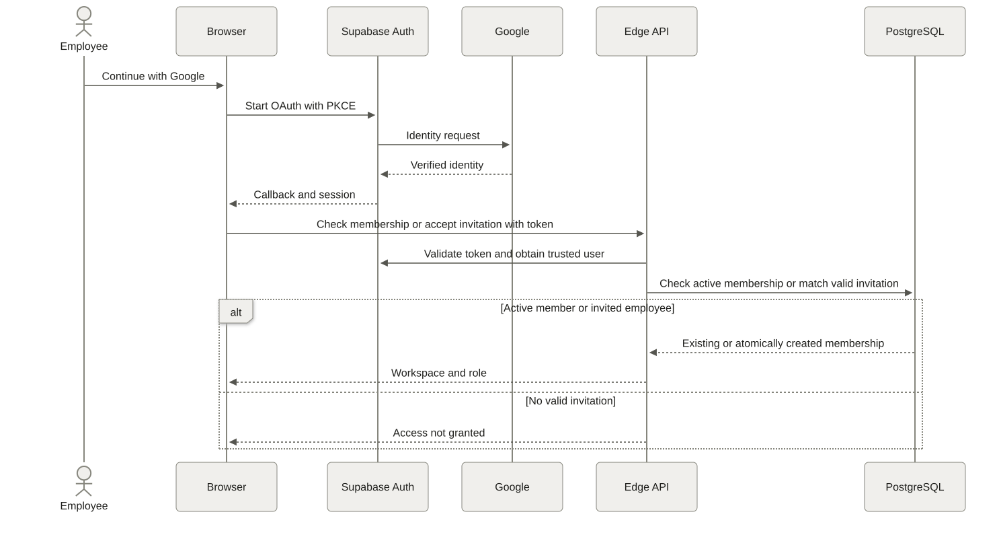
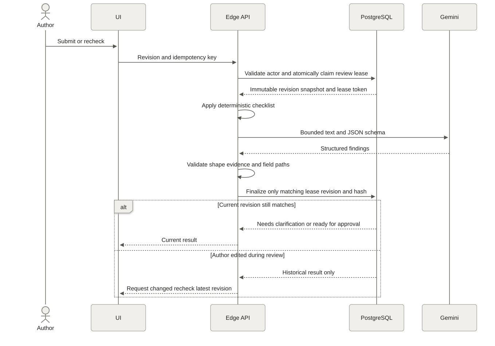
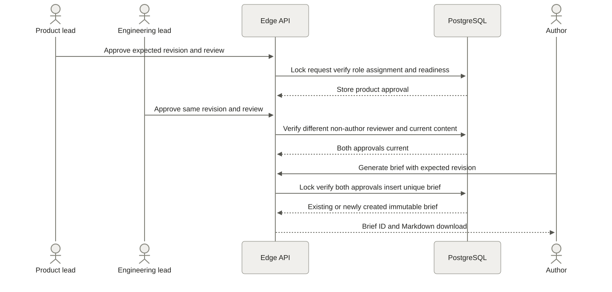

# HandoffCheck Architecture

Product to engineering feature handoffs for a software company

Version 1.0 · 13 October 2026 · Architecture specification

## 1. Purpose and decisions

HandoffCheck turns a product manager's feature request into a reviewed implementation brief. It checks required information, asks specific clarification questions, records decisions, and requires product and engineering approval of the same revision before producing a brief. Approval confirms the agreed handoff; it does not guarantee technical feasibility, estimate delivery effort, or commit an engineering team to a release.

This specification adapts the marketing workflow in `../HandoffCheck_Project_Description.docx` for product and engineering. The React app, hosted Supabase backend, and Google login are connected. The owner selected Forms → Sheets → HandoffCheck → approved Google Docs as the next integration. See [GoogleWorkspace.md](GoogleWorkspace.md) for its diagram, permissions, and acceptance checks, [Implementation.md](Implementation.md) for current status, and [Setup.md](Setup.md) for setup. The original 1–2 day estimate applied to the smaller Google Workspace workflow.

### Confirmed by the project owner

| Decision | Selected scope |
| --- | --- |
| Team | 10–20 invited employees in one software company |
| Handoff | Product manager to engineering, feature requests and implementation briefs |
| Authentication | Google login; synthetic/demo requirements initially |
| Review | Both a product lead and an engineering lead approve |
| Supporting material | Reference links, private screenshots, and PDFs |
| Output | In-app brief and Markdown download; users copy it into existing tools |
| Interface | Light theme, compact tables, neutral colors; no blue or purple accents or gradients |
| Hosting preference | Free hosting, authentication, database, and file storage where suitable |

### Implementation defaults to validate in the pilot

One workspace and one feature checklist. Every active member can read workspace requests; authors edit their own requests. Assigned leads review and approve. Approval requires two different people, neither the author. Workspace administration does not automatically confer approval rights. The project owner approved these pilot permission rules and asked to build and test locally before configuring Supabase or Google OAuth.

The owner selected Vercel for web hosting, GitHub Actions for manual deployment, and a Windows installer. Supabase provides Auth, PostgreSQL, private Storage, and Edge Functions. The Windows app uses Electron and opens Google sign-in in the system browser. See [Deployment.md](Deployment.md). Gemini review remains optional and the pilot uses deterministic checklist review.

No autonomous agents, vector database, Kubernetes, Redis, separate always-on backend, or model training are needed for this workload.

## 2. Product boundaries

### Included

- Login, invitations, membership revocation, and role assignment.
- Workspace request list, draft editor, assigned reviewers, and revision history.
- A versioned engineering checklist and deterministic required-field validation.
- AI language review for ambiguity, conflicting scope, and missing explanations.
- Clarification threads whose accepted answers are incorporated into request fields.
- Private screenshot/PDF references; the model reviews text fields only.
- Product and engineering approvals tied to a reviewed revision.
- Immutable approved briefs, Markdown export, and audit history.
- Visible processing failures, controlled retries, and stale-result handling.

### Deferred

Bug intake, automated ticket creation, Slack/email notifications, source-code inspection, URL fetching, document extraction/OCR, repository access, sprint planning, effort prediction, and multi-company tenancy. Forms intake, Sheet tracking, Apps Script automation, and approved Doc export are now in scope; see the separate integration design. No work execution or release deployment occurs through HandoffCheck.

## 3. System diagram

The browser and Windows app download a public application shell. All company content requires an authenticated workspace membership. Vercel serves static files; business APIs run in Supabase.


[Editable Mermaid source](diagrams/system.mmd)

Rendered diagrams and editable sources are in [diagrams](diagrams/README.md). [Design.md](Design.md) specifies screens, typography, components, and interaction behavior.

## 4. Technology choices

| Layer | Choice | Responsibility and reason |
| --- | --- | --- |
| Language | TypeScript | Shared request contracts and explicit boundary validation |
| Frontend | React + Vite | Authenticated browser application; no SEO or server rendering requirement |
| Routing | React Router | List, editor, review, brief, and settings routes |
| Styling | Tailwind CSS + CSS variables | Implement the tokens in Design.md without a separate visual framework |
| Accessible primitives | Radix UI | Dialogs, tabs, menus, and focus behavior; style to the project tokens |
| Forms | React Hook Form + Zod | Field validation, field arrays, and shared JSON schemas |
| Remote state | TanStack Query | Read caching, invalidation, and short-lived review polling |
| Icons | Lucide React | Small functional icons with accompanying labels |
| Browser data client | Supabase JS | Google authentication, RLS-protected reads, and authorized storage uploads |
| API runtime | Supabase Edge Functions, Deno | Validate commands, call review provider, verify files, create exports |
| Database | Supabase PostgreSQL | Relational permissions, revisions, approvals, jobs, and transactional consistency |
| Identity | Supabase Auth with Google OAuth | Existing employee accounts; membership is controlled separately |
| File storage | Supabase Storage private bucket | Screenshot/PDF objects with request-scoped policies |
| AI | Gemini Developer API | Bounded structured language review; optional deterministic-only mode |
| Frontend hosting | Vercel | Static Vite application with provider subdomain and security headers |
| Desktop | Electron, electron-builder, NSIS | Windows x64 installer; system-browser Google login with PKCE loopback return |
| Source and deployment | Private GitHub repository, npm lockfile, GitHub Actions, Vercel and Supabase CLIs | Manual release workflows, reproducible builds and backend deployment |
| Verification | Vitest, Testing Library, Playwright, SQL permission tests | Business rules, interactions, and cross-user access |

Installed versions are pinned in package.json and package-lock.json. Provider-native `fetch` handles the optional AI request; an AI orchestration library is unnecessary.

The underlying projects are documented by [React](https://react.dev/), [Vite](https://vite.dev/guide/), [React Router](https://reactrouter.com/), [Tailwind CSS](https://tailwindcss.com/docs), [Radix UI](https://www.radix-ui.com/primitives/docs/overview/introduction), [React Hook Form](https://react-hook-form.com/), [Zod](https://zod.dev/), [TanStack Query](https://tanstack.com/query/latest/docs/framework/react/overview), [Lucide](https://lucide.dev/guide/packages/lucide-react), [Vitest](https://vitest.dev/), and [Playwright](https://playwright.dev/docs/intro).

## 5. Workload and service targets

These are planning assumptions and implementation targets, not measured performance.

| Input | Pilot assumption |
| --- | --- |
| Registered users | 10–20; typically 2–5 active together, test 20 sessions |
| Requests | 200 new requests/month |
| Revisions | 3 saved revisions/request on average |
| AI runs | At most 3/request on average, about 600/month |
| API and data reads | Budget 40,000/month, paginated and indexed |
| Request size | At most 24,000 UTF-8 bytes across reviewed fields |
| AI output | At most 16 KB validated JSON, bounded arrays |
| Attachment limit | 5 active files/request, at most 5 MB/file |
| Expected attachments | 2 files/request, about 0.5 MB/file; around 200 MB/month before deletion |
| Retention default | Demo records and files removed after 60 days; short pilot audit retained 90 days |

At roughly 30 KB of text and findings per revision, 600 revisions/month is around 18 MB/month before indexes, audit data, and database overhead. Actual PostgreSQL size must be measured. Two months of the expected attachment workload is around 400 MB; the maximum upload allowance is much larger and cannot be treated as a monthly storage budget.

Target list/editor API p95 below 1 second under pilot load, and usable list rendering below 2 seconds on a normal office connection. Target AI completion within 30 seconds with a 25-second provider timeout. Limit simultaneous AI requests to two per workspace, further reduced if actual model quotas require it. No uptime SLA is promised on the free plans.

## 6. Authentication and authorization

### Login and onboarding



[Editable Mermaid source](diagrams/authentication.mmd)

1. An administrator records an invited email, application role, and seven-day expiry. The app does not send mail; the administrator shares the login URL using the existing team process.
2. Google identifies the employee through Supabase OAuth. Only identity scopes are needed; do not request Drive, Gmail, or repository permissions.
3. The backend verifies the Supabase token and reads the current Auth user. An existing active member returns to the workspace directly. Otherwise, match a confirmed, normalized email to an unused invitation; consume it and create membership in one transaction. A revoked member needs an explicit new invitation from an administrator.
4. An uninvited user may have an Auth account but receives no workspace data. Domain matching or successful OAuth alone never grants membership.
5. Bootstrap the first administrator through a controlled setup migration/operator procedure. There is no public first-user-becomes-admin flow.

Use current Supabase-supported JWT verification, validating issuer, audience, expiry, and signature; decoding token contents is insufficient. For invitation acceptance, use a trusted current Auth user lookup. Check current membership in PostgreSQL on every command and in each read policy so a revoked user loses data access even with an unexpired token. Do not authorize using editable profile metadata. See [Google login](https://supabase.com/docs/guides/auth/social-login/auth-google), [JWT verification](https://supabase.com/docs/guides/auth/jwts), and [Edge Function security](https://supabase.com/docs/guides/functions/auth).

For the demo SPA, let Supabase JS manage a browser session. Tokens remain exposed to browser JavaScript; use a strict Content Security Policy, escaped text, no raw HTML, and no unneeded third-party scripts. Logout clears local sessions and caches. A production review must decide whether browser token persistence is acceptable or a backend session with HttpOnly cookies is required.

Configure exact production and local callback URLs. Do not authorize arbitrary preview domains. Preview environments use separate synthetic data and their own explicitly registered callback URL.

### Role matrix

| Capability | Member/author | Product lead | Engineering lead | Administrator |
| --- | --- | --- | --- | --- |
| Read workspace requests, reviews, and briefs | Yes | Yes | Yes | Yes |
| Create request; edit own request | Yes | Yes | Yes | Yes |
| Edit another person's requirements | No | No | No | No |
| Comment and answer assigned questions | Yes | Yes | Yes | Yes |
| Run review on request | Own | Own or assigned | Own or assigned | Own |
| Product approval | No | Assigned, non-author | No | No |
| Engineering approval | No | No | Assigned, non-author | No |
| Generate brief | Author after both approvals | Assigned after both approvals | Assigned after both approvals | If also author |
| Invite/revoke members, assign roles | No | No | No | Yes |
| Publish checklist and manage retention | No | No | No | Yes |

Membership has one primary role for the pilot. Require separate users for the two approval slots. An administrator can assign lead roles but cannot bypass revision or approval rules. Prevent removal/demotion of the last active administrator. Revocation and role changes are audited.

### Database boundary

- Enable RLS on every exposed table, including audit, findings, comments, and attachment metadata. Anonymous access is denied.
- Browser reads use the public project key and user JWT; every policy joins current active membership and the relevant workspace.
- Revoke direct client writes on workflow tables. Expose narrowly scoped transactional RPCs for editing, review starts, approvals, and brief creation. These enforce `auth.uid()`, membership, ownership, expected revision, and operation limits even if called without the Edge API.
- Use `SECURITY DEFINER` only where needed, a fixed safe `search_path`, fully qualified names, explicit grants, and no caller-supplied actor identity. Test direct Data API/RPC calls as well as UI paths.
- User commands use the user's scoped database client. A server credential is limited to validated AI-result finalization, trusted file inspection, invitation identity matching, and operator tasks. These paths explicitly enforce their own constraints because privileged credentials bypass RLS.

## 7. Feature request contract

Drafts can be incomplete. Submission must pass the baseline checklist. A conditional field accepts `not_applicable` only with a reason where the checklist permits it.

| Field | Required for baseline review | Expected content |
| --- | --- | --- |
| Title | Yes | Specific behavior, at most 120 characters |
| Problem and evidence | Yes | Who has the problem, current behavior, evidence or explicit evidence gap |
| Target users | Yes | User segment and applicable roles |
| Desired behavior | Yes | Main flow and observable outcome |
| Scope and exclusions | Yes | Deliverables and explicit boundaries |
| Acceptance criteria | Yes | At least one testable criterion; UI encourages Given/When/Then |
| Edge cases | Yes | Failure/empty/permission cases or justified not-applicable |
| Dependencies and constraints | Yes | Dependencies, or explicit none known |
| Data and permissions impact | Yes | Data touched, user permissions, or explicit no change |
| Success measure | Yes | Metric or observable result; no invented numerical goal |
| Priority and rationale | Yes | Low/normal/high and business reason |
| Target delivery | Conditional | Desired date and timezone, or explicit not scheduled |
| Design/reference links | Optional | Figma, tickets, or documents; no requirement to add nonexistent design |
| Attachments | Optional | Verified PNG/JPEG or PDF references |
| Product and engineering reviewer IDs | Yes before submission | Active users with the correct role, different from author and each other |

Cap acceptance criteria at 20, links at 10, text fields at documented per-field lengths, and total reviewed text at 24 KB. Store dates in ISO form with an IANA timezone; timestamps use UTC and the UI shows the workspace timezone, initially `Asia/Karachi` as a demo default. Requester/reviewer IDs come from membership, not free-text names.

Links are validated as HTTPS references and never fetched by the backend or model. Do not send employee emails, private object URLs, or raw file contents to the model. Attachment metadata and reviewer assignment are still part of the revision snapshot and hash.

## 8. Lifecycle and revision rules



[Editable Mermaid source](diagrams/lifecycle.mmd)

Archive is a separate flag available to the author or administrator, with an audit event. Archived requests remain readable and cannot mutate until restored. Any outstanding review result for an archived request is retained as history but cannot advance its current state.

Every successful content save appends an immutable revision with a monotonically increasing number. A revision contains the complete requirements, attachment manifest, reviewer assignments, canonical input hash, and checklist version. Metadata-only comments and UI preferences do not change the revision. Adding/removing a file or changing reviewers does.

Submitting or rechecking the current revision before brief generation can replace its review and invalidate its current approvals. Once a brief exists for a revision, further review requires a new revision, even if its requirement text is unchanged. This preserves one immutable brief per revision without substituting new approval provenance into an existing artifact.

Use canonical JSON with a documented key order, LF newlines, and SHA-256 on the server. Do not normalize away meaningful whitespace inside user content. Approval identity is the tuple `(request_id, revision_no, input_hash, review_id, checklist_version)`. Both approvals must reference the same successful review; starting a new review invalidates earlier current approvals. Preserve old approval rows as superseded history.

Checklist publication does not silently rewrite existing revisions. Existing requests retain the checklist version they were reviewed against; an explicit checklist upgrade creates a new revision. Record prompt and model version on each review for reproducibility.

## 9. Data model


[Editable Mermaid source](diagrams/data-model.mmd)

### Table and constraint details

| Table | Important fields and constraints |
| --- | --- |
| `workspaces` | Name, timezone, retention settings, AI enabled flag; one seeded workspace |
| `memberships` | Unique workspace/user, role enum, active/revoked status; trusted role source |
| `invitations` | Normalized email, role, inviter, expiry, consumed user/time; no public email listing |
| `checklist_versions` | Immutable checklist JSON, published version, author/time |
| `requests` | Short display ID such as HC-0042, workspace, author, revision pointer, current review pointer, minimum revision required after a changes request, state, archive flag |
| `request_revisions` | Unique request/revision, immutable JSON, content hash, product/engineering reviewer IDs, checklist version, editor/time |
| `review_runs` | Revision/hash, state, prompt/model/checklist versions, provider request ID when available, lease token, timeout, token usage, readable error code |
| `findings` | Review, kind, field path, question, evidence quote, severity, origin deterministic/AI/human; immutable original finding; human change requests use a server-only kind unavailable to the model |
| `finding_resolutions` | Finding, action, rationale, actor/time; resolution cannot dismiss deterministic mandatory failures |
| `comments` | Request, optional finding, author, text, created time; discussion does not modify requirements |
| `approvals` | Review/revision/hash, stage product/engineering, reviewer/time; unique review/stage; server enforces distinct reviewers |
| `briefs` | Unique revision, review ID, both approval IDs, Markdown, template version and checksum; immutable artifact |
| `stored_files` | Workspace/request, owner, opaque object path, original name, declared/verified type, bytes, reserved/pending/verified/rejected state, expiry |
| `revision_files` | Unique revision/file; only verified files may enter a saved revision |
| `audit_events` | Workspace, request if relevant, actor, event, revision, timestamp, correlation ID; append only |
| `command_receipts` | Workspace/actor/operation/idempotency key, request payload hash, result pointer, expiry; no token storage |

Enforce same-workspace relationships through composite foreign keys or transaction checks; a UUID alone is not authorization. Index requests by `(workspace_id, archived, updated_at DESC, id)` and assigned reviewer; revisions by `(request_id, revision_no)`; review runs by revision/state and lease expiry; comments/audit by request/time. Add a partial unique index allowing only one running review per revision. Enforce a unique object path and a unique brief per revision.

No separate `tasks` table is needed in v1. The brief's implementation checklist is an agreed list of work, not a sprint tracker. Add ticket synchronization only after validating the handoff workflow.

## 10. Review processing and AI contract

### Review sequence



[Editable Mermaid source](diagrams/review.mmd)

1. The API verifies current membership, author/assignment, expected revision, archive state, and review limits.
2. A transaction locks the request and workspace review counter, claims one job, and stores a 90-second lease. Exclude expired leases from active concurrency counts. Repeated commands return the same review status/result.
3. Required-field rules run in code. The model cannot erase a failure or supply a missing value as a fact.
4. Send a fixed instruction, checklist version, and delimited feature fields. No tools, network fetching, attachments, or action permissions are available to the model.
5. Validate structured output independently of provider schema enforcement. Evidence must quote the supplied field, field paths must exist, and arrays/text lengths must stay within limits. An unsupported claim is not saved as verified evidence.
6. A server-only finalizer checks the lease token and review snapshot before storing results. It advances the request only if it still points to that revision and review; otherwise the result is historical.
7. Derive readiness in code. All deterministic mandatory failures and unresolved blocking findings prevent approval. Leads may dismiss an AI finding with a reason; mandatory code failures require a revision. Answers count toward readiness only after the author incorporates them into requirements and rechecks.

Illustrative provider response:

```json
{
  "schema_version": "1",
  "findings": [
    {
      "kind": "ambiguity",
      "field": "desired_behavior",
      "severity": "blocking",
      "evidence_quote": "Users can export reports",
      "question": "Which user roles may export a report, and which formats are required?",
      "explanation": "The request does not specify export permissions or file formats."
    }
  ],
  "potential_misunderstandings": [],
  "unknowns": ["Export formats", "Export permissions"]
}
```

Allow finding kinds `missing_detail`, `ambiguity`, `conflict`, and `risk`; severities `blocking` or `advisory`; at most 10 findings, 3 potential misunderstandings, and 10 unknowns. Missing-field evidence can be empty only for a missing-detail finding. Never return a readiness status from the model as an authoritative workflow decision. Review summaries remain advisory text.

Use [Gemini structured output](https://ai.google.dev/gemini-api/docs/structured-output) and validate with the application's shared schema. Pin `prompt_version`, `schema_version`, and actual model ID.

### Failure and quota handling

Review processing writes a durable job before contacting the provider. Foreground requests can process it inside the HTTP invocation; the private signed worker recovers queued work when configured. A disconnected browser reads the stored result on return. Each worker claim rechecks authorization, revision, policy and budget, then acquires a bounded lease. A late old finalizer cannot overwrite a replacement run.

Provider timeout, malformed JSON, invalid evidence, and quota failures preserve inputs and approvals remain unavailable. Network/server failures use at most three budgeted queue attempts, eligible after delays of 30 and 60 seconds. Review retries require the private scheduler; the review remains running with an extended expiry while waiting. Rate-limit, invalid-output and access/configuration failures stop for a deliberate retry. Exhausted attempts fail visibly. No retry sleeps inside a provider call. A new manual review uses a new command key; approval and brief generation do not receive automatic retries with new keys.

The request summary exposes read-only metadata for the job attached to its current review. Active UI phases distinguish queued work and retry delays from an active provider attempt; the stored workflow status stays Reviewing until the run settles. Assistant jobs carry their saved review-run IDs so responses and historical errors are associated with the correct run. Personal chat clearing affects browser visibility only, scoped to the signed-in member and conversation; it does not delete the records used by reviews or approvals.

Start with 10 review runs/user/hour and 50/workspace/day, plus two simultaneous runs. Enforce limits transactionally on review claims, including direct RPC access. Adjust below actual model quotas where necessary. Keep review disabled if no approved provider configuration exists.

Deterministic-only mode can run the same workflow without the AI API. Record `mode=checklist_only` and show that language ambiguity has not been reviewed; the two human approvals still apply. It is a deliberate mode, not a silent fallback after an API failure.

## 11. Approval and brief consistency



[Editable Mermaid source](diagrams/approval.mmd)

Approval and generation are database transactions, not read-then-write checks in JavaScript. Serialize save, review, approval, and generation on the same request row. A save arriving first invalidates approval; generation arriving first creates a valid artifact for the earlier revision, which the later save marks historical in the UI.

At approval and generation time, recheck that both assigned reviewers still have active membership and the correct lead role. An access or role change can make an earlier approval unusable for new generation; an already generated artifact stays historical evidence. A lead's Request changes decision creates a blocking human decision and requires a new saved revision and successful review before approval resumes. Rechecking unchanged text cannot dismiss that decision.

The generation template deterministically uses approved fields; it does not ask AI to rewrite or expand scope. Include problem, audience, scope/exclusions, desired behavior, acceptance criteria, edge cases, data/permissions, dependencies, references, target date/timezone or not scheduled, reviewer decisions, revision/hash, approval names/times, and a checklist derived from acceptance criteria. Do not invent implementation subtasks or estimates.

`briefs` stores Markdown text in PostgreSQL, so generating a brief requires no additional file object. Downloads use authenticated endpoints and `Content-Disposition: attachment`. References to files point to authenticated in-app attachment routes, not temporary signed URLs. Exported Markdown intentionally carries the approved data; users handle the downloaded file under their team's sharing process.

## 12. API and transaction contract

Use one Edge Function router named `handoff-api` at `/functions/v1/handoff-api`. The paths below are relative to that function. Every authenticated request uses a Supabase user bearer token. Reads may also use RLS-protected Data API queries.

| Method and path | Action | Main constraint |
| --- | --- | --- |
| `POST /membership/accept` | Consume invitation | Trusted confirmed Auth email, unexpired invitation |
| `GET /me` | Membership and capabilities | Current membership status |
| `GET /requests` | Paginated filtered list | Workspace RLS, stable cursor, max 50/page |
| `POST /requests` | Create draft revision 1 | Member, request size, idempotency key |
| `GET /requests/:id` | Current revision and status | Workspace member |
| `POST /requests/:id/revisions` | Save immutable next revision | Author, expected revision; reset current approval state |
| `POST /requests/:id/reviews` | Submit/recheck | Author or assigned lead; lease, quota, expected revision |
| `GET /reviews/:id` | Result or effective timed-out status | Same workspace; no mutation required for reads |
| `POST /findings/:id/resolutions` | Dismiss supported AI finding | Assigned lead, rationale, current review; no code-rule override |
| `POST /requests/:id/comments` | Clarification answer/comment | Member; text limits; no implicit field update |
| `POST /requests/:id/approvals` | Product or engineering approval | Assigned stage, different non-author users, current review |
| `POST /requests/:id/change-requests` | Require clarification | Assigned lead, reason; invalidate both current approvals |
| `POST /requests/:id/briefs` | Create or return brief | Both current approvals; unique revision |
| `GET /briefs/:id` | Read approved artifact | Active workspace member |
| `GET /briefs/:id/markdown` | Download `.md` | Active workspace member, no-store |
| `POST /requests/:id/files/reservations` | Allocate upload path/quota | Author, owned draft, size/type limits |
| `POST /files/:id/complete` | Inspect uploaded object | Reservation owner; signature/size match |
| `GET /files/:id/download` | Short-lived download URL | Current workspace member, verified and retained object |
| `POST /requests/:id/archive` | Archive/restore | Author or admin; expected revision |
| `POST /admin/invitations` | Record invitation | Administrator only |
| `POST /admin/members/:id/role` | Assign/revoke | Administrator; protect last admin |
| `POST /admin/checklists` | Publish checklist version | Administrator; immutable versions |

Mutation bodies include `expected_revision` when applicable and the `Idempotency-Key` header. Scope command receipts by user, workspace, operation, and key; bind each to a payload hash. Reuse with a different payload returns 409. Retain ordinary command receipts for seven days; permanent unique constraints still protect approvals and briefs after receipt expiry.

Example error:

```json
{
  "error": {
    "code": "REVISION_CHANGED",
    "message": "This request changed. Reload it before approving.",
    "correlation_id": "server-generated-id",
    "current_revision": 4
  }
}
```

Use 400 for malformed input, 401 for expired/missing identity, 403 for known denied actions, 404 for objects outside the user's workspace, 409 for stale/conflicting commands, 422 for unmet workflow checks, 429 for limits, and 502/504 for upstream review failures. Never return provider secrets or raw stack traces. Restrict CORS to explicitly configured application origins; CORS is not authorization. Send sensitive API responses with `Cache-Control: no-store`.

## 13. Private file storage

Use one private bucket, `request-files`, and opaque paths:

```text
<workspace_uuid>/<request_uuid>/<file_uuid>
```

1. Allocate a reservation transactionally. Count active and pending reservations against per-request and workspace limits. Store the declared size/type and a 30-minute reservation expiry.
2. Upload directly with the user's JWT to the allocated path. Storage RLS checks current membership, author ownership, the pending reservation, and expiry. Deny overwrite/upsert, arbitrary paths, and client deletion of retained revision files. Bucket settings enforce the 5 MB maximum and allowed MIME types.
3. Completion inspects object bytes/size using the server credential and verifies PNG, JPEG, or PDF signatures. Ignore the extension as proof. The object remains unavailable to other members until verified. This is format validation, not malware detection.
4. Add verified files to the next revision through a normal content save. Removal also creates a revision; older revisions keep their attachment manifest until retention cleanup.
5. Downloads require membership and a verified retained object. Issue a five-minute signed URL. Treat that URL as a bearer credential: it can remain usable until expiry after logout/revocation. Never store it in a brief, log, or AI payload.

PNG/JPEG can use an authenticated screenshot preview; PDFs download with an attachment disposition and are not embedded in the page. No SVG, HTML, executable, archive, or office document uploads in v1. The application does not parse or send attachments to AI. Malware scanning is not provided by this design; introducing real-company file uploads requires a chosen scanning/quarantine process or a documented company policy accepting that limitation.

Keep pending uploads hidden, delete rejected/expired objects during operator cleanup, and reconcile reservations/objects before releasing quota. A failed object deletion remains marked for retry so the app does not falsely report reclaimed storage. Workspace application budget: 700 MB of reserved/verified bytes, leaving headroom below provider storage quota. Set alerts at 500 MB and 650 MB; reject reservations past the budget. Monitor actual provider usage because abandoned objects can diverge from application counters.

Private buckets use RLS and authenticated or signed downloads. See [Storage access control](https://supabase.com/docs/guides/storage/security/access-control) and [private bucket behavior](https://supabase.com/docs/guides/storage/buckets/fundamentals).

## 14. Free deployment and cost boundaries

Provider limits were checked on 13 October 2026. They can change; check account usage and current terms before activating a pilot. A free-tier architecture is a capacity choice, not a guarantee of free operation forever.

| Service | Selected free use | Boundary |
| --- | --- | --- |
| Vercel Hobby | Personal synthetic pilot and provider subdomain | Personal, noncommercial use only; company operation requires an eligible plan |
| Supabase Free | One pilot project; optional second synthetic staging project | 500 MB database/project, 1 GB storage, 50,000 monthly active users, 500,000 Edge invocations, 5 GB uncached egress; confirm organization quota scope |
| Supabase Auth + Google OAuth | Employee login | Google social login is used; enterprise SAML SSO is outside this design |
| Gemini eligible free tier | Synthetic text review | Model/account/region quotas vary; unpaid-service data handling matters |
| Private Git and local build tools | Source and manual deploy | Any hosted CI must stay within that account's included minutes/storage |
| Domain and email | Provider subdomain; no transactional email | A custom domain and external mail service are optional separate costs |

The quota figures come from [Supabase billing](https://supabase.com/docs/guides/platform/billing-on-supabase). Free projects may pause after a week of inactivity and only two active free projects are included. See [Supabase pricing](https://supabase.com/pricing) and [Vercel Hobby terms](https://vercel.com/docs/plans/hobby).

Supabase free Edge Functions allow 150 seconds of wall time, 2 seconds CPU/request, and 256 MB memory. Keep hashing, schema validation, file inspection, and template generation bounded; do not render PDFs or process images server-side. See [function limits](https://supabase.com/docs/guides/functions/limits).

The owner selected the current Vercel account for the personal pilot. No paid plan is purchased by deployment. Confirm plan eligibility before company operation.

The infrastructure pilot can target $0/month within these allowances. AI is free only for eligible models and within actual account quotas. Google states that unpaid services may use inputs/outputs to improve products and advises against sensitive/confidential submissions; use synthetic data as agreed. Before processing real requirements, configure a company-approved provider and data policy. See [Gemini terms](https://ai.google.dev/gemini-api/terms) and [model pricing](https://ai.google.dev/gemini-api/docs/pricing).

Upgrade triggers: required uptime/backups, sensitive-data policy, database approaching 350 MB, files repeatedly reaching the 650 MB warning, egress approaching 80% of the account allowance, or review throttling interfering with daily work. First consider retention and unnecessary traffic; then price the relevant paid plan. Do not add a separate database or storage provider simply to avoid one measured limit.

## 15. Deployment and configuration



[Editable Mermaid source](diagrams/deployment.mmd)

Use npm with a committed lockfile and supported Node LTS for build tools; Supabase functions run on Deno. A local Supabase instance requires the supported CLI and Docker. A small hosted synthetic staging project is an alternative if local containers are unavailable.

Proposed repository layout:

```text
doc/
  Architecture.md
  Design.md
  diagrams/
src/
  app/                 routes, providers, authenticated shell
  features/            requests, reviews, approvals, briefs, settings
  components/ui/       shared visual primitives
  lib/                 auth, data client, error and query helpers
shared/
  contracts/           request, finding and API schemas
  domain/              checklist rules, canonical hashing, template contract
supabase/
  migrations/          tables, grants, RLS and transactional RPCs
  functions/handoff-api/
    routes/
    services/          review provider, file validation, export
tests/
  domain/
  database/
  e2e/
public/                favicon, static headers and font files if needed
vercel.json
electron-builder.json
desktop/               native shell and PKCE callback
.github/workflows/     checks, manual deployment and manual installer release
package.json
package-lock.json
```

Shared contracts must be usable by both the browser build and Deno; use explicit import mapping and no Node-only runtime dependencies in shared domain code. PostgreSQL remains the authoritative enforcement layer for transitions; UI copies of validation improve feedback but cannot authorize a command.

| Setting | Location | Exposure |
| --- | --- | --- |
| `VITE_SUPABASE_URL` | Frontend build | Public project URL |
| `VITE_SUPABASE_PUBLISHABLE_KEY` | Frontend build | Public key; security depends on RLS |
| Project server credential | Edge managed secrets | Server only; never a Vite variable |
| `GEMINI_API_KEY` | Edge secret | Server only |
| `GEMINI_MODEL_ID` | Edge configuration | Pinned supported model ID |
| `ALLOWED_APP_ORIGINS` | Edge configuration | Exact localhost/staging/production origins |
| `REVIEW_MODE` | Workspace/server configuration | `ai` or explicit `checklist_only` |
| Google client ID/secret | Supabase Auth configuration | Provider secret stays in Auth |
| Deploy access tokens | Operator/CI secret store | Scoped provider credentials |

Frontend routing uses Vercel SPA fallback:

```json
{
  "rewrites": [{ "source": "/(.*)", "destination": "/index.html" }]
}
```

Register the Supabase provider callback in Google and the app `/auth/callback` URL in Supabase. If company Google Workspace supports an internal OAuth application, prefer it; otherwise configure the approved external consent/testing setup. No real credentials or provider project IDs are placed in this document.

Vercel's [Vite documentation](https://vercel.com/docs/frameworks/frontend/vite) describes SPA routing. `vercel.json` contains CSP, frame restrictions, MIME sniffing prevention and referrer policy. Its connection policy permits the selected Supabase origin. Never deploy secrets inside `dist`. The retained Wrangler configuration is an alternative, outside the selected release workflow.

Deploy database migrations first, then compatible Edge code, then frontend assets. Use additive migrations for rollback safety. Roll back frontend/function versions if necessary; restore data from backup only for a data incident, not as a routine code rollback. Preview builds never point to the real-company production project.

## 16. Operations and retention

Log correlation ID, operation, actor UUID, request/revision, elapsed time, provider outcome, and quota counters. Do not log tokens, employee email lists, request body text, signed URLs, or file contents. Audit domain events persist independently of provider log retention.

The administrator checks database size, actual bucket bytes, egress, failed review rate, expired leases, and rejected uploads weekly during the pilot. Display review errors and current service configuration in Settings. Poll running reviews every three seconds while visible, stop after completion or timeout, and refetch on page focus; no workspace-wide frequent polling or Realtime dependency is required.

Run a weekly operator cleanup for demo retention, expired file reservations, command receipts, and orphaned objects. Record deletion outcomes and retry failures. If continuous cleanup becomes necessary, schedule the same idempotent procedure; scheduling is an implementation extension, not an existing service.

Do not assume free hosted backups are sufficient. Before onboarding, capture schema, data, and role/grant exports with the supported Supabase CLI, and separately export Storage objects/manifests. Store encrypted copies outside the project in company-controlled storage. Synthetic pilot default: weekly backup, recovery-point target seven days, operator recovery-time target one business day. These are targets to demonstrate with a staging restore, not guarantees. Real-company usage needs its own recovery objectives and backup schedule. [Supabase backup guidance](https://supabase.com/docs/guides/platform/backups)

A restore runbook must recreate Auth user mappings, membership, private bucket policy, objects, functions, OAuth settings, and secrets, not only request rows. Test restoring into synthetic staging and verify one complete brief and attachment access. Provider outages show a service-unavailable state; never substitute fabricated review findings.

## 17. Implementation work and acceptance evidence

| Phase | Work | Required evidence |
| --- | --- | --- |
| 1 Identity and data | Tables, RLS, invitations, Google login, roles, migrations | Uninvited/revoked users denied through API and direct Data API; seeded employees can log in |
| 2 Request workflow | List, form, revisions, references, files, comments | Save conflicts handled; invalid files hidden; content history remains immutable |
| 3 Review | Checklist, provider adapter, JSON validation, leases, quota limits | Complete/missing/ambiguous inputs, malformed output, timeout, injection text, concurrent edits |
| 4 Approval and brief | Two stages, transactional gates, Markdown template/export | No self-approval; distinct leads; stale approvals denied; repeated generation returns one artifact |
| 5 Pilot readiness | Responsive UI, access tests, restore rehearsal, deploy and setup guide | End-to-end browser evidence, storage access tests, 20-session workload rehearsal |

Test at least 15 synthetic feature requests: complete scope, missing fields, vague permissions, conflicting acceptance criteria, absent evidence, explicit no target date, no applicable design, Unicode text, malicious embedded instructions, and concurrent revision changes. Add file cases for unsupported MIME, oversized file, forged extension, stale reservation, expired download URL, and cross-workspace file access.

Critical concurrency tests: two leads approve together; author saves during review; author saves during approval/generation; two generate calls produce one brief; old review finalizes after a replacement lease; one revoked lead attempts approval; direct RPC calls try to bypass review limits or write approval rows.

A UI build and successful login do not demonstrate the permission model. Verify policies using anonymous, invited, active member, author, each assigned lead, administrator, revoked member, and another workspace's user fixtures. Load targets remain unverified until measured against a hosted synthetic project.

## 18. Remaining company decisions

- Confirm that all employees may read all pilot feature requests, or define project-level access before implementation.
- Confirm the proposed distinct-reviewer and no-self-approval policy, plus who will hold administrator and lead roles.
- Review the baseline checklist with one product lead and one engineering lead.
- Choose the real company name, Google OAuth owner, and database region using company requirements and provider availability.
- Before using real data, decide provider approval, attachment scanning, retention, backup objectives, and session policy.

The pilot is implemented and deployed; [Implementation.md](Implementation.md) records actual evidence and remaining acceptance work.

## 19. Automation extension

The implementation adds `automation_policies`, `automation_jobs`, `ai_usage`, recipient-scoped notifications, and `linear_connections` / `linear_handoffs`. Jobs capture an immutable revision and input hash. Private worker leases are withheld from client projections. Claims and finalization recheck active membership, assignment, source and policy version; attempts have per-user and workspace budgets. The existing revision and approval commands remain authoritative.

An Edge-only Gemini adapter serves review, edit suggestions, summaries and QA drafts. An author accepts edits through the canonical save command; QA review is recorded separately by the assigned engineering lead. Optional automatic brief creation invokes the existing deterministic command after both approvals. Neither AI output nor a task state can approve requirements.

The separate signed worker uses a Vault/Edge HMAC credential, timestamp and nonce. Supabase Cron performs a conditional minute check through `pg_net`; no due work means no Edge invocation. Linear handoff stores the exact confirmed payload and a persisted issue UUID, then checks the authenticated sender and destination before an outbound mutation. A retry reconciles that UUID before creating an issue. Current approved artifacts alone can initiate a new handoff.

See [AutomationPlan.md](AutomationPlan.md) for workflow diagrams and [AutomationSetup.md](AutomationSetup.md) for deployed configuration, retry behavior, retention and pending account-level acceptance. The native Windows app continues using the same hosted UI and authentication bridge.
