# HandoffCheck automation plan

14 October 2026 · Automation design for the 10–20-person pilot

This plan extends the existing product-to-engineering workflow. The owner subsequently requested implementation and selected Linear. Requirement edits, summaries, QA drafts, the task queue, in-app reminders, optional automatic briefs and confirmed Linear handoffs are implemented. The backend and private scheduler have been deployed; workspace features remain disabled. Gemini credentials are deferred, and Linear credentials and team selection are pending. See [AutomationSetup.md](AutomationSetup.md) for configuration and implementation limits, and [Implementation.md](Implementation.md) for verification.

## 1. Outcome

Reduce the repeated work of finding unclear requirements, writing clarification questions, preparing reviewers and turning agreed requirements into implementation material. Keep authors responsible for requirements and the two assigned leads responsible for approval.

The proposed flow is:

**Form or app intake → draft → author confirms requirements and reviewers → checklist and AI review → clarification and accepted edits → two human approvals → stored brief → Google Doc and engineering handoff.**

[Editable diagram](diagrams/automation-workflow.mmd)

## 2. Starting point

| Capability | Current implementation and evidence |
| --- | --- |
| Google login, workspace membership and roles | Deployed; owner confirmed Requests opens in both web and installed Windows app |
| Drafts, immutable revisions, assigned reviewers, dual approval and Markdown briefs | Implemented; application, SQL and browser regression checks passed |
| Private screenshot/PDF storage | Implemented; hosted upload/download acceptance is pending |
| Forms → Sheets → HandoffCheck → private Google Docs | Connector and backend deployed; asset binding verified; complete live acceptance is pending |
| Required-field review | Implemented; the pilot was deployed in checklist-only mode |
| Gemini review | Existing adapter supports ambiguity, conflicts, missing details, possible risks and clarification questions; no live provider acceptance recorded |
| Suggested edits, reviewer summaries, QA drafts and in-app reminders | Implemented behind admin feature switches; provider calls remain unverified |
| Background AI queue and scheduler | Implemented using durable Postgres jobs, signed Edge worker and conditional Cron dispatch |
| External ticket creation | Linear connector implemented with exact payload/destination confirmation; live key and team are pending |

[Implementation.md](Implementation.md) records current verification. [Architecture.md](Architecture.md) owns the existing permission and revision rules. [GoogleWorkspace.md](GoogleWorkspace.md) owns the connector contract.

## 3. Automation by stage

| Stage | Regular application automation | Proposed AI assistance | Person in control |
| --- | --- | --- | --- |
| Intake | Verify Google membership, map Form fields and import one draft per response | Later, organize author-provided notes into suggested fields | Author confirms meaning and fills gaps |
| Preparation | Validate required fields and reviewer assignment | None needed for checking empty fields | Author selects the two leads |
| Requirement review | Capture exact revision, run checklist, enforce quotas | Identify ambiguity, conflicting statements, missing explanations and possible implementation risks | Author or assigned lead starts review; later, author submission can trigger it |
| Clarification | Store questions, discussion and version history | Ask short questions supported by the submitted text | People answer; author updates requirements |
| Requirement edits | Compare suggestions against the current revision and validate accepted changes | Suggest clearer wording and testable acceptance criteria | Author accepts individual edits or writes their own |
| Review preparation | Display what changed and unresolved issues | Produce a short reviewer summary | Leads inspect the source requirements and evidence |
| Approval | Verify current revision, reviewer role, distinct identities and resolved blockers | AI findings are advisory evidence for people to evaluate | Both assigned leads approve; neither is the author |
| Brief | Generate the existing deterministic brief from the approved revision | Optional supplementary summary, clearly labelled | Author or assigned lead generates the canonical brief initially |
| Google export | Existing Apps Script exports stored approved artifacts and acknowledges Doc IDs | None needed | Google owner manages Drive sharing and connector access |
| QA preparation | Link draft tests to the approved artifact and its criteria | Suggest positive, negative, permission and boundary test cases | Engineering/QA reviews and accepts the draft |
| Follow-up | Detect assigned reviews waiting beyond configured thresholds and show in-app reminders | None needed for reminder timing | Admin configures thresholds; people act on reminders |
| Ticket handoff | Copy/download Markdown; later create a ticket in a selected destination | Optional draft ticket description based on the approved artifact | Authorized person reviews the exact payload before external creation |

Treat details absent from the request as questions or explicit proposals. Only an author's accepted requirement change can make a proposal part of the recorded requirements. A valid source quote does not prove that a model's conclusion is correct; reviewers still evaluate it. Reviewer summaries and QA drafts supplement the approved brief; they do not replace it.

## 4. Example with automation

This is a fictional feature: **Export filtered tasks as CSV**.

1. Nadia, a member/product manager, submits the Form. Apps Script records it in Sheets and imports a draft. The existing connector still needs its live acceptance test.
2. Nadia opens the draft, confirms its contents and assigns Sara as product lead and Omar as engineering lead. Intake does not automatically make an incomplete draft ready for approval.
3. Nadia selects **Review requirements**. Required fields are checked. With AI configured, the model flags “export tasks” and asks whether this means the current page or all matching tasks. It also asks about empty results and large exports.
4. Nadia answers in the discussion and edits the requirements: export all matching tasks, cap the export at 5,000 rows, and show a clear message for empty results.
5. In a later phase, **Suggest acceptance criteria** proposes tests for filters, headers, missing due dates and comma escaping. Each proposal links to the source requirement. Nadia accepts the useful suggestions, producing a new revision.
6. The reviewed revision passes the checklist and its blocking questions are resolved. Sara and Omar independently inspect and approve that same revision.
7. The canonical brief is generated. Apps Script exports the stored approved artifact into a private Google Doc. Google sharing remains a separate owner action.
8. **Draft QA checklist**, a proposed addition, prepares tests tied to the approved brief. Bilal and QA review them before using them in the team's existing ticket tool.
9. If Nadia changes the export limit later, the app creates another revision. Earlier approvals and QA drafts remain historical; the changed requirements require fresh approval.

## 5. Permissions and human decisions

The existing four roles remain unchanged. Each account has one primary role.

| Action | Member/author | Assigned product or engineering lead | Administrator | Automation worker |
| --- | --- | --- | --- | --- |
| Read workspace requests | Yes | Yes | Yes | Only the task's permitted source |
| Request review/edit assistance | Own request | Assigned request, or own request as author | Own request | Only a previously authorized queued task |
| Request a QA draft | Any approved workspace brief | Any approved workspace brief | Any approved workspace brief | Only a previously authorized queued task |
| Mark QA draft reviewed | No | Assigned engineering lead for its source request | No | No |
| Apply requirement edits | Own request | Own request as author | Own request | No autonomous edits |
| Approve a stage | No | Assigned stage, if not the author | No | No |
| Dismiss an AI finding | No | Assigned lead, with recorded reason | No | No |
| Generate canonical brief | Own request after both approvals | Assigned request after both approvals | Own request after both approvals | Optional later automation only through a narrowly authorized transaction |
| Configure automation policy | No | No | Proposed admin control | No |
| Create an external ticket | Existing copy/export; connected creation needs a later policy | Same | Chooses allowed destinations | Only an explicitly approved artifact and destination in a later phase |

Proposed QA drafts are readable by active workspace members. The assigned engineering lead records their reviewed state; other members can inspect and copy them for testing. That state does not approve or modify the source requirements.

An admin's configuration changes are audited. Disabling AI stops new AI jobs and changes future review behavior; it does not silently approve a request whose review failed. Revocation, archiving and role changes are rechecked before pending jobs execute or publish results.

An AI-generated instruction, reviewer summary or imported document is content. It cannot authorize membership changes, approvals, deployments, Google sharing or external messages.

## 6. UI and interaction design

Extend the existing request detail, editor, review queue, brief and Settings screens. Keep the system font stack, warm neutral surfaces, charcoal controls and semantic status colors in [Design.md](Design.md). Use the existing dialog and form components. No new accent palette is proposed.

| Surface | Proposed controls and behavior |
| --- | --- |
| Request review | Existing checklist and findings, with clear **Checklist** or **AI review** origin, field link, quoted evidence, question and explanation |
| Draft editor | **Suggest edits** opens a field-by-field comparison; **Accept edit** is available only to the author and saves through the normal revision transaction |
| Review queue | Short **AI summary** with links to actual fields and changes; the complete request stays available |
| Approved brief | **Draft QA checklist** creates a separate labelled draft with an approved-revision reference |
| Request activity | Records who requested assistance, which version it used, completion/failure, and accepted suggestions |
| Settings → Automation | Proposed admin controls for review behavior, trigger policy, feature access, limits, provider status and pause/resume |

The canonical `review_mode` remains `checklist_only` or `ai`. A separate proposed trigger policy distinguishes manual review from review on explicit submission. Feature toggles for edit suggestions and QA drafts are separate from approval permissions.

Visible task states: **Queued**, **Working**, **Waiting to retry**, **Response ready**, **Failed**, **Outdated** and **Cancelled**. Accepted edits and reviewed QA drafts have their own recorded state. Failed AI work shows a useful retry action and never appears as a successful review. A summary does not use a fabricated readiness or confidence score.

Keyboard users can inspect, accept and dismiss proposals. Put generated content in the normal page flow or an on-demand dialog; avoid persistent overlays. Display quoted source text as escaped text. Preserve 320-pixel browser layout and the Windows app's existing resizing behavior.

## 7. Technical design

[Editable diagram](diagrams/automation-system.mmd)

### Phase 1: reuse the existing request path

The browser or desktop app sends its authenticated review command to `handoff-api`. `handoff_start_review` authorizes the actor, checks reviewer assignments, captures revision/hash and enforces review quotas. The existing adapter calls Gemini with structured output. Validation checks schema and quoted evidence before `handoff_finish_review` publishes findings for the matching review lease.

The implementation returns deterministic missing-field questions first and defers the provider call until those fields are complete. Review remains an explicit submission action; it does not run on every edit or keystroke.

One shared Edge-only provider module serves review and assistance. The canonical database review finalizer remains the authority for findings. Apps Script and the browser do not implement another review rules engine. Google's [structured-output documentation](https://ai.google.dev/gemini-api/docs/structured-output) supports the adapter's schema-based approach; the selected model's REST compatibility still needs a real synthetic request after key configuration.

### Durable tasks and background processing

Use Postgres task records and a small Supabase Edge worker for background AI work. Retain the existing `review_runs` as the review authority. A task record coordinates execution; it does not provide another approval state machine.

Installed scheduling uses Supabase Cron and `pg_net` to invoke the worker only for due work, an enabled reminder scan or daily retention maintenance. Both extensions are available on the selected pilot project. Supabase documents [Postgres Cron](https://supabase.com/docs/guides/cron) and [scheduled Edge Functions](https://supabase.com/docs/guides/functions/schedule-functions). Scheduler credentials are in Vault and Edge secrets; provider keys stay in Edge secrets.

The public publishable key does not authorize worker actions. The worker must verify a dedicated internal signed request with timestamp and replay protection before using privileged clients. Reuse the existing signature primitives where appropriate, with a separate secret and scope from the Google Workspace bridge. Permit only task claiming and task-specific finalization RPCs; do not expose a general SQL or command execution endpoint.

For 10–20 users, process at most two provider tasks concurrently. A SQL scheduler can check for due tasks each minute without invoking the Edge worker when the queue is empty. This is a proposed polling target, not a latency guarantee. Phase 1 needs no scheduler.

### Proposed records

| Record | Purpose and key fields |
| --- | --- |
| `automation_policies` | Workspace, policy version, enabled features, trigger policy, limits, changed-by actor and timestamp |
| `automation_jobs` | Workspace/request, task type, authorized actor, revision/hash or approved brief ID, policy/prompt/model versions, idempotency key, state, lease, attempts, next attempt and sanitized error |
| `ai_suggestions` | Task ID, target field or criterion, source evidence, proposed text, source revision/hash and acceptance decision; workspace-scoped member reads and author-controlled acceptance |
| `ai_usage` | Provider attempts, recorded input/output usage when available, workspace/day and model; server-controlled writes |
| `in_app_notifications` | Recipient, source event and request, read status and deduplication key; recipient-scoped reads |
| Existing `review_runs`, findings, approvals, briefs and audit events | Continue owning review evidence, human approval and canonical artifacts |

These are proposed tables, not migrations. Apply RLS, explicit grants, validated contracts and narrow transactional functions during implementation. Record complete provider output only when needed for the validated result; avoid duplicating request bodies in job metadata.

### Proposed API operations

Reuse existing review and workflow commands. New authenticated operations may request edit suggestions, retrieve their status, accept selected edits against an expected revision, request reviewer summaries and request QA drafts for an approved brief. Admin-only operations configure the versioned automation policy. Route names and contracts are finalized during implementation; no new public worker route is enabled by this plan.

Suggestion acceptance validates authored fields and creates a normal immutable revision. A model cannot write reviewer IDs, roles, approval state, priority or dates as an accepted fact without an explicit author choice and permitted field validation.

## 8. Reliability and version safety

1. Capture an immutable source revision/hash, policy version and permitted actor when a person requests a task. A client cannot supply a different actor.
2. Build the deduplication key from workspace, request, task type, source version and task parameters. The same job is claimed once under a bounded lease.
3. Immediately before the provider call, recheck active membership, task permission, source version, archive state and feature policy. Cancel disallowed work without sending data.
4. Validate bounded JSON output, allowed fields and evidence. Generated text remains escaped content and has no tool authority.
5. Before publishing, compare current source state and lease. A result for an older revision becomes **Outdated** and cannot change the current request or approvals.
6. Suggested edits require author acceptance against the same expected revision. A conflict asks the author to regenerate against current text.
7. Retry transient connection/provider failures at most twice, with backoff and any provider retry guidance. Authentication, schema and unsupported-model failures require operator correction. Each provider attempt consumes the budget; retries may produce repeated provider charges.
8. A missed trigger is recovered by the task queue. A crashed worker's expired lease can be reclaimed; attempts and idempotency prevent unbounded duplicate processing.
9. Canonical brief generation and Doc export remain deterministic. Google export reuses the connector's existing artifact identity and retry behavior.

For optional automatic brief generation, refactor the canonical brief generation logic into a reusable transaction helper invoked after the second valid human approval. Record the authorized lead and exact approved review. Avoid impersonating a user in a background worker or granting a bot general approval permissions. Keep manual generation available until this behavior passes its own acceptance tests.

## 9. Data and cost controls

Start with synthetic requests. The current adapter excludes names, comments, reference URLs and attachments. Proposed summaries and QA drafts should also use only approved text fields and criterion identifiers. Expanding to discussion content or attachments requires a separate data-policy decision and explicit inclusion controls.

Google documents that unpaid Gemini services may use submitted material to improve products and advises against sensitive/confidential submissions. Applicable treatment depends on account, billing and regional terms. Check [Gemini terms](https://ai.google.dev/gemini-api/terms) and [pricing](https://ai.google.dev/gemini-api/docs/pricing) before company data is sent.

Proposed pilot limits reuse the current review limits of 10 reviews per employee/hour, 50 workspace reviews/day and two concurrent reviews. The existing counters include checklist reviews. Additional AI features need a shared provider-attempt budget so adding suggestions does not bypass the limits. Model output and request sizes remain bounded; retain the existing 24 KB authored-text limit and 25-second provider timeout for review unless measured requirements justify a change.

Select a supported model available to the actual account, test structured output and pin its ID. Do not assume a ChatGPT subscription, Google login or Cloud OAuth client supplies API access. Keys are entered directly into provider/local secret settings. No automatic model upgrade, paid fallback or paid subscription is enabled.

Pause new provider work when configured limits or budget are reached. Reserve the bounded per-call usage estimate before dispatch and reconcile reported usage afterward. Budget controls need to allow for in-flight work and missing provider usage; they do not guarantee an exact bill. Provider billing controls remain the backstop. Show quota failures clearly. Log actor/request IDs, task type, source version, timings and usage when reported; exclude tokens, source bodies, private file links and employee email lists. Decide job/suggestion retention before implementation and align cleanup with the existing operator retention process.

Vercel continues hosting the static UI. AI calls stay in Supabase. Phase 1 adds provider usage but no new hosting service. Later scheduling consumes database and Edge capacity and must be measured against account allowances. Free-plan uptime and provider quotas remain operational constraints; the current Vercel Hobby deployment is the personal pilot described in Deployment.md.

## 10. Rollout and acceptance

| Phase | Deliverable | Required evidence before enabling broadly |
| --- | --- | --- |
| 0: establish the baseline | Verify hosted files and complete one synthetic Form → draft → both approvals → private Doc workflow | One imported draft, one approved artifact, one private Doc; repeat sync without duplication; uninvited intake creates no request |
| 1: AI requirement review | Configure and test existing adapter; keep review explicitly initiated | Real synthetic provider call, evidence validation, sensible questions, denial/timeout/malformed-output tests, stale-result handling and unchanged dual-approval rules |
| 2: author and reviewer assistance | Field edit suggestions, reviewer summaries and QA drafts | Author-only acceptance, correct revision conflict handling, source-linked criteria, no invented facts presented as agreed requirements, accepted changes invalidate current approvals |
| 3: background automation | Optional review on explicit submission, task queue, in-app reminders and optionally automatic brief creation | Restart/retry recovery, quota enforcement across features, revocation/pause handling, no stale writes, no duplicate briefs, visible task errors |
| 4: selected external handoff | Choose one ticket or notification destination; require review of each exact payload initially | Destination allowlist, scoped credentials, correct artifact mapping, current permission check, deduplicated creation and visible external failures |

All provider work now receives a durable task record. Foreground requests attempt the selected job synchronously; optional background processing returns promptly and starts work through the Edge runtime. The private scheduler recovers accepted queued work independently of the browser. No provider-backed completion is claimed until credentials and real acceptance are in place.

Measure review turnaround, clarification cycles, suggestion acceptance/rejection, erroneous blockers, provider failure rate, task delays, duplicate side effects and actual API usage. Establish a baseline from pilot observations; no productivity percentage or savings estimate is assumed. Track whether approved requirements still change because of avoidable misunderstandings.

Keep deployment manual through the existing GitHub Actions workflow. Database/functions deploy before dependent UI changes. Test with synthetic fixtures, then run real provider and Google acceptance separately. The native app uses the same hosted UI; native authentication and preload boundaries remain unchanged.

## 11. Decisions before implementation

| Decision | Proposed default |
| --- | --- |
| First build | Phase 0 acceptance, then Phase 1 AI review |
| Provider | Reuse Gemini adapter after supported-model and account checks |
| Data | Synthetic text; retain current exclusions |
| Trigger | Manual review first; explicit submission later, never every keystroke |
| Author control | Accept suggestions individually; save a normal revision |
| Approval | Two distinct assigned humans; neither the author |
| Final brief | Existing deterministic approved artifact |
| Background execution | Supabase/Postgres task queue only when needed |
| Reminders | In-app first; external delivery remains unselected |
| Engineering handoff | Keep Markdown copy/download until a ticket destination is chosen |
| Provider budget and retention | Admin-selected limits with clear stop behavior; retention must be agreed before storing new AI artifacts |

The owner requested implementation after reviewing this plan. Linear is the selected ticket platform. The rollout above remains an acceptance checklist: coding or deploying a feature does not establish live provider quality, real ticket delivery or completed Google Workspace acceptance. Feature switches and external credentials remain explicit configuration steps.
