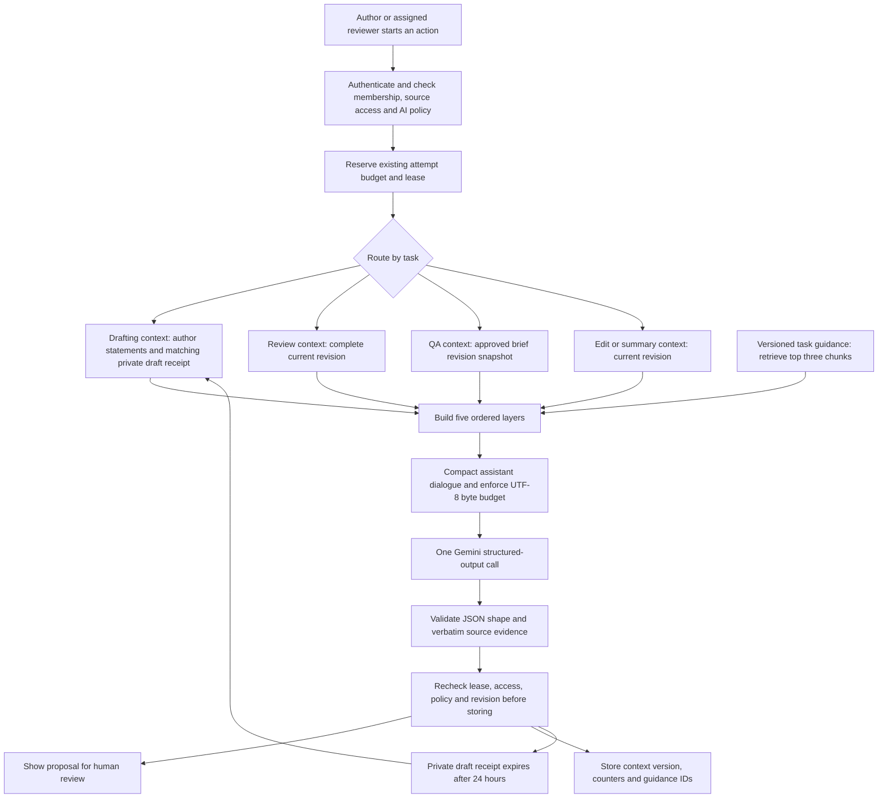

# AI context engineering

15 October 2026 · `handoff-context-v1`

HandoffCheck assembles a new, bounded context package for each Gemini call. The custom TypeScript adapter remains the runtime; Supabase PostgreSQL holds private draft receipts, immutable request revisions, approved brief snapshots and usage records. This layer needs no additional service, dependency or API key.

## Request path

The selected task is the supervisor's routing decision. Each specialist gets a separate, stateless context and one model call. There is no parallel agent discussion, shared scratchpad or autonomous tool loop. Drafting does not receive another person's review history; QA does not receive the drafting conversation. This preserves the isolation benefit without extra model calls for this pilot.

## Five layers

| Order | Content | Boundary |
| --- | --- | --- |
| 1. Role and goal | A short role for drafting, requirement review, edits, reviewer summary or QA | Application-owned system instruction |
| 2. Constraints | Treat submitted content as data; no tools, URL/file access, permission changes, request creation or approvals; require source evidence and plain language | Application-owned system instruction |
| 3. Reference data | Top-three relevant guidance chunks and the authorized source for this action | Guidance is application-owned; author text, revisions and saved proposals are untrusted data |
| 4. Examples | One small input/output example for the selected task | Labelled illustrative; examples do not establish feature facts |
| 5. Task and output | The active task, evidence/index rules and the exact JSON schema | Last context section; Gemini structured output enforces the same schema |

Layers 1–2 use Gemini's `systemInstruction`. Layers 3–5 are ordered JSON sections in the user content. Submitted text is serialized inside the source object; it is never interpolated into system instructions. The structured-output schema is also passed through `generationConfig.responseJsonSchema` as before. Prompt separation reduces confusion; it does not make prompt injection impossible. Authentication, permissions, allowed actions and output validation remain enforced outside the model.

## Write: scoped external memory

Drafting reuses `intake_turns`, the existing author-scoped response receipts. It stores the validated structured response, including proposed fields and their evidence, without storing the input transcript. Proposal evidence can contain author text. This is a short-lived draft scratchpad, not a permanent user profile or a shared company memory.

On a new turn, `intake_claim` first reserves the existing budget/lease. It then looks for a successful receipt whose input hash matches the exact preceding conversation prefix: remove the new author message and the immediately preceding assistant message. Lookup requires the same workspace, actor and policy version, a ready response, and an age below 24 hours. Changed conversation text, another author, another workspace, expired receipts and a changed policy cannot match. An idempotent replay returns the original response without another generation.

The adapter validates every retrieved proposal against verbatim quotes in the current author's messages before sending it. Saved proposals carry `accepted: false`; later author corrections take precedence, and unresolved conflicts must be raised as questions. The model's summary never becomes an authoritative requirement. The author still checks the latest preview, edits the form and explicitly saves or submits it.

Receipts expire after 24 hours and are deleted on the next workspace intake claim or daily maintenance. Leaving the builder clears the browser conversation. Memory is not a resumable chat history across sessions; the browser must still supply the bounded conversation. Starting again begins from the new input. Identical prefixes from the same author may reuse the same matching proposal; receipt lookup is content matched, not a separate conversation-ID store.

For review, edits and summary, the existing immutable revision is the authoritative external state. QA receives the revision snapshot associated with the approved brief. Historical AI answers, comments and other requests are not added as requirement facts. Existing finalizers reject stale or unauthorized results.

## Select: just-in-time source and guidance

`shared/ai-context.ts` owns a small versioned guidance library: scope, acceptance criteria, permissions, boundaries, drafting, review, QA and editing. Each action filters by task, ranks by keyword overlap, gives task-specific baseline guidance priority and takes at most three chunks with stable tie-breaking. Drafting ranks against the latest author answer; revision tasks rank against the selected revision. Guidance IDs are recorded in the context manifest.

This is local, deterministic retrieval over curated guidance. It is not embedding search, semantic tool routing or retrieval from company documents. The library contains review advice, not customer facts, company policies or example feature requirements. Source quote validators do not allow guidance as evidence. If a guidance phrase also appears in the actual source, the quote alone still does not establish the model's conclusion; people check meaning.

The source is allowlisted. Revision tasks receive text fields plus priority, scheduling and timezone, without reference URL objects, uploaded file contents, memberships, account IDs or unrelated record properties. Review retains all requirement fields for cross-field conflict detection. QA retains the complete approved revision and original criterion order. No criterion is removed or renumbered to reduce context size.

There are no provider-callable tools. Routing is deterministic by the requested action, and each specialist receives only its applicable schema and example. Future company-document retrieval would need an explicit source-ingestion and access policy, source versions, permission-filtered chunks and citation contracts; it is not enabled by this change.

## Compress: preserve facts, remove repeated assistant output

All author messages remain verbatim with their original zero-based `messageIndex`. The builder keeps the most recent assistant messages in a four-message window. Older full assistant responses are omitted; the preceding question associated with each author answer is retained, capped at 600 characters. This preserves what an answer was responding to while removing repeated assistant summaries. A matched receipt supplies structured proposed fields and their evidence, without copying its narrative summary or answer options.

This is deterministic compaction, not an extra model-generated summary. It costs no additional provider call and does not replace author evidence with paraphrases. A long assistant question can be shortened; author text is never silently cut. The existing 40-message, 3,000-character/message and 46-KB transcript limits still apply.

The serialized Gemini request, including both schema occurrences, must fit **120,000 UTF-8 bytes**. An over-budget request fails before network access with an explicit context-limit error. It does not silently discard source facts or raise quotas. This byte limit is an input guard, not an exact token estimate. Actual prompt/output token counts are recorded only when supplied by Gemini. The existing 6,000 output-token cap, 25-second request timeout, 80-KB response cap, attempt budgets and retry rules remain in force.

## Isolate: specialist and permission boundaries

Each context is built from arguments for one action, with no module-level mutable request memory. The server obtains the source through existing authenticated or lease-checked database operations. The same canonical participant predicate still controls request content. Admin status does not confer access to private drafts or employee request content.

Human approval and draft creation remain regular application commands. The model cannot call these commands. Requirement review findings remain advisory, and QA drafts require engineering review. Output validation preserves the existing field quotes, criterion indexes and author message evidence rules; adding context does not relax them.

## Observability and maintenance

`ai_usage.context_manifest` records only the application version, task, exact serialized request bytes, source bytes, count of omitted full assistant messages, whether draft memory was used, and up to three recognized guidance IDs. The SQL normalizer drops unknown keys and unrecognized IDs. It does not store prompts, model reasoning, source excerpts, API keys or a transcript in telemetry. Existing receipt/AI artifacts retain their own documented content and access policies.

Successful calls and provider/validation failures after assembly carry a manifest into the existing finalizers. Failures before context assembly have no manifest. The manifest is private operational data alongside existing usage records; there is no new end-user telemetry screen. Successful context-based review attempts record `handoff-context-v1` as the review prompt version. Existing saved results are not rewritten.

When changing role rules, guidance, example meaning or compaction behavior, bump the context version and update the SQL manifest allowlist, tests and this document together. Changing the output shape also requires existing domain/schema and database evidence validators to change coherently.

## Verification and limits

Automated cases cover ordered layers, separation of injected source text, relevant deterministic retrieval, isolated requests/tasks, preservation of author quotes and criterion indexes, invalid memory rejection before network access, byte limits, schema-valid examples, exact payload measurements, token reporting and HTTP 503 handling. PostgreSQL tests cover author/workspace/prefix/policy/expiry isolation, revocation, private helper privileges, finalizer leases, telemetry filtering and unchanged attempt budgets.

These are synthetic provider tests and real local PostgreSQL execution. They do not establish improved live model quality or immunity to injection. Gemini outages, API/model configuration errors and quotas can still fail a call. A useful pilot comparison is to run the same synthetic feature through drafting, review and QA, then compare factual accuracy, missing-detail questions and criterion coverage with the prior version.

## Design references

[Anthropic's context-engineering guidance](https://www.anthropic.com/engineering/effective-context-engineering-for-ai-agents) informed the small relevant context, compaction, external notes and isolated sub-contexts. [ByteByteGo's guide](https://blog.bytebytego.com/p/a-guide-to-context-engineering-for) provides the write/select/compress/isolate framing. The requested five-layer sequence is HandoffCheck's deterministic assembly convention; these references do not establish a universal order or precedence guarantee for every model.
