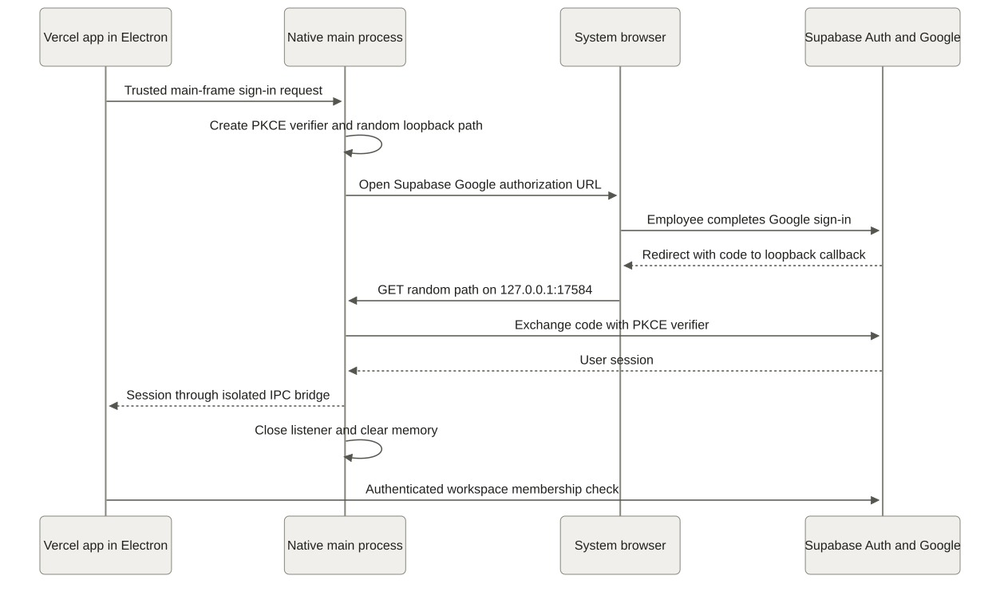

# Web deployment and Windows releases

HandoffCheck uses Vercel for the public application shell and Supabase for Google authentication, workspace permissions, database transactions and private files. The Windows app loads the same production application. It requires internet access.

## Targets

| Resource                  | Target                                                  |
| ------------------------- | ------------------------------------------------------- |
| Production app            | https://handoffcheck.vercel.app                         |
| Private source repository | https://github.com/codera647/HandoffCheck               |
| Vercel team               | `codera647s-projects` / `team_75Ikyytg6OGvW0iRj2fKq0Gg` |
| Vercel project            | `handoffcheck` / `prj_V9ypX6L1VaibAC6iz4uyabASnggd`     |
| Supabase project          | `dpwzjmqvsqifbgspoylc`                                  |
| Native app                | Windows x64, Electron 44.7.0, assisted NSIS installer   |

The selected Vercel account uses Hobby. Its [terms restrict use to personal, noncommercial projects](https://vercel.com/docs/plans/hobby). This deployment is the personal synthetic-data pilot. Company operation requires an eligible plan; no paid plan is purchased by these workflows.

## Deployment controls

Pushes and pull requests run `Checks`. Deployment requires manually starting **Deploy production** on `main`. The production environment permits only `main`. Required-reviewer protection was unavailable on the repository's current GitHub plan; the owner selected manual dispatch instead.

The production environment contains the secret `VERCEL_TOKEN` and variables `VERCEL_ORG_ID` and `VERCEL_PROJECT_ID`. Store the token directly in GitHub settings. It is exposed only to CLI authentication steps. `.env`, `.vercel`, local tools, generated desktop settings and build output are ignored by Git.

Production Vercel settings:

```dotenv
VITE_SUPABASE_URL=https://dpwzjmqvsqifbgspoylc.supabase.co
VITE_SUPABASE_PUBLISHABLE_KEY=sb_publishable_OwNeZrT5S9kAfH2TYas5Yg_bPYFV755
VITE_ENABLE_DEMO=false
```

These are public build settings. Database access still requires a valid user session and row policies. No service-role key, Google secret or Workspace bridge secret is shipped in the frontend or installer.

Start a deployment through GitHub → Actions → Deploy production → Run workflow → main, or:

```powershell
.\.tools\gh\bin\gh.exe workflow run deploy.yml --ref main
```

The workflow runs TypeScript, application/SQL tests, desktop authentication tests, browser workflows and the production build. It checks the linked Vercel project, stages a production build without assigning domains, checks `/`, `/login` and `/auth/callback`, then promotes that exact deployment. It does not deploy SQL migrations or Edge Functions. Backend changes require their own reviewed deployment before publishing a dependent frontend.

For rollback, inspect the existing deployment and project first, then use the pinned Vercel CLI to roll back to the chosen previously working production deployment. Rollback does not reverse database migrations or Google Docs exports.

## Google return URLs

Supabase Site URL is `https://handoffcheck.vercel.app`. Allowed returns:

```text
https://handoffcheck.vercel.app/auth/callback
http://127.0.0.1:5174/auth/callback
http://localhost:5174/auth/callback
http://127.0.0.1:17584/auth/callback/*
```

The native return uses one fixed loopback address and port with a random path per attempt. The Google OAuth client's authorized redirect remains `https://dpwzjmqvsqifbgspoylc.supabase.co/auth/v1/callback`. A Google account must still have an active membership or valid employee invitation to enter the workspace.

The Edge Function origin allowlist includes the production domain and both local development origins. The desktop renderer uses the production origin, so it needs no additional API origin.

Update `APP_URL` in the owner's Apps Script to `https://handoffcheck.vercel.app` and save. The canonical [Code.js](../google-workspace/Code.js) contains that value. This changes app links in Sheet tracking rows; it does not recreate the Form or change approval permissions. Existing rows may need a later sync to refresh their links.

## Desktop design and authentication



[Editable diagram source](diagrams/desktop-auth.mmd)

The Windows window uses the existing interface, fonts and neutral colors. External reference links open in the system browser. Google authentication also opens in that browser, where the employee completes sign-in directly.

The native main process creates a PKCE verifier in memory and listens on `127.0.0.1:17584` at a random callback path. Supabase returns a code there; the main process exchanges it and passes the resulting session to the trusted app frame. The listener closes on success, denial, cancellation or a five-minute timeout. The verifier and main-process storage are cleared. The renderer stores its session through the existing Supabase client.

The renderer has no Node access. Context isolation, sandboxing and web security remain enabled. Only the pinned HTTPS app origin and main frame can invoke the sign-in bridge. Embedded webviews and arbitrary native IPC are unavailable. The preload exposes only the sign-in operation.

## Build and release

```powershell
npm ci
npm run test:desktop
npm run desktop:dev
npm run desktop:package
```

`desktop/production.json` contains public production settings. `desktop:prepare` validates them and writes ignored generated configuration. Packaging produces `release/HandoffCheck-0.1.0-windows-x64-setup.exe`.

Create a version tag matching `package.json`, push it, and manually run **Release Windows installer** on `main` with that tag. The workflow checks the tagged revision, verifies it belongs to `main`, builds on Windows, calculates SHA-256, and publishes a GitHub prerelease with the installer and `SHA256SUMS.txt`. Publishing uses the job's temporary GitHub token; Vercel credentials are not used for releases.

The repository is private, so release downloads require GitHub access. Verify a downloaded installer with `Get-FileHash -Algorithm SHA256` and compare with the release checksum file.

The installer is unsigned because no signing certificate is configured. Windows may display an unknown-publisher warning. The native shell has no automatic updater; install a newer release to update Electron or native authentication code. Web UI updates appear from the live production domain.

## Verification limits

Local tests cover workflow transactions, private file rules, request revisions, two-lead approval, exports, narrow layouts and the native callback's success and failure paths. Native callback tests substitute the Google provider boundary. They do not prove a real Google consent flow.

Complete these checks manually with synthetic data after deployment: web Google sign-in, installer Google sign-in, a private upload/download, a Form submission appearing as a draft, both lead approvals, and a private approved Doc export. The Google assets are bound in Supabase, but the completed Form-to-Doc workflow has not yet been observed.

The desktop build toolchain currently has moderate dependency advisories without a published upstream fix. Runtime and build-tool dependency reports must be evaluated separately; no forced downgrade or policy bypass is used to hide the findings.
