# HandoffCheck Interface Design

Product to engineering feature handoffs

Version 1.0 · 13 October 2026 · UI and UX specification

## Public information pages · 15 October 2026

`/about`, `/privacy` and `/terms` are static HTML entries, readable without JavaScript, authentication or a backend connection. They use the existing neutral palette, system font and brand mark, a narrow reading column, dated policy text and ordinary section/anchor navigation. No decorative panels or new accent colors are introduced. Information links appear on sign-in and in the workspace sidebar; full-page anchors load the public documents. A public overview links the policies and app entry for OAuth branding. Contact uses the existing project maintainer email. Current unpaid-Gemini and synthetic-data restrictions are explicit. Print styles keep the policy text legible.

## Approval reminder schedule · 15 October 2026

Request detail has a collapsed **Approval reminder schedule** in the status sidebar. Keyboard or pointer expansion loads its saved setting. Authors can enable repeat reminders, select minutes/hours/days, choose email as an additional channel, then save. Leads read the schedule with disabled controls. Use the existing neutral sidebar, form, failure and success styles, with no new accents or decorative panels.

Show next due time in the workspace timezone, last in-app cycle and email acceptance/status. Distinguish waiting for review, scheduled, paused, stopped, unavailable scheduler, pending Gmail setup and delivery unknown. Author-only Connect Gmail, Reconnect Gmail and Disconnect Gmail controls sit beside sender metadata and explain the account-wide connection. Google consent is separate from login. Leads read the sender status without mailbox controls. Preserve inputs after failed saves and offer refresh for version conflicts. Show success only for the returned server version. The notification list shows refreshed timestamps and links to Approvals. See [Reminders.md](Reminders.md) for the behavior and setup contract.

## 1. Design purpose

### Conversational request builder and private navigation · 15 October 2026

New feature request offers Describe with assistant alongside the manual form. The neutral conversation view asks one missing-detail question at a time, offers optional answer buttons and explains recommendations. The proposed form appears beside the conversation on desktop and below it on narrow screens. Each proposed field includes a disclosure quoting the author's answer. Missing fields are labelled; suggestions are not silently accepted. A checkbox confirms the exact latest preview before Use draft in form. The editable form still requires the author to choose both leads and explicitly save or confirm submission. Chat itself does not create a request. Failed messages retain the prior preview and offer Retry message; busy, disabled, empty and transcript-limit states remain visible.

My requests contains the current author's requests. My reviews contains current submitted assignments. Private drafts and newly saved revisions remain author-only until submission. Unrelated members, former reviewers and administrators do not get a request link or content through those screens; direct inaccessible links show a neutral not-found state. Source files and AI results follow the same access. Both distinct lead approvals remain required. Switching accounts resets editor/chat state. The conversation is not stored in the browser or shown to reviewers.

### Guided requirement assistant · 15 October 2026

The owner selected guided actions in a conversation view. Use the existing neutral palette, compact type and normal page flow. A bounded activity feed pairs each requested task with its real state and structured response. Show queued, working, waiting to retry, failed, completed and historical results accurately. Keep older revisions available in collapsed entries, source quotes behind labelled disclosures, and suggested changes beside their saved source. The action bar offers requirement review, edit suggestions, reviewer summary, and approved-brief QA. Copy uses readable text. Accepting an edit keeps the existing author confirmation and new-revision transaction; AI never approves a request. Do not display fabricated streaming, reasoning, progress percentages or free-text chat controls.

Active reviews show Review queued, Retry pending or Retrying review in both request views and tables; a failed attempt awaiting retry is distinct from the final Review error state. The newest task and response appear first. Chat messages link to their saved review run, show its questions and source evidence, and collapse previous-review errors. The active-task strip names the task, revision and attempt independently of the history filter. Checklist reviews also have readable saved responses.

The owner selected personal Clear chat with Restore messages. Clearing hides existing conversation entries for the current workspace, account, request and brief on this device. It retains saved requirements, review runs and approvals. Running work continues and a new task-state change can appear after clearing. Requesting an already-saved response reveals that response without implying a new generation. Changing accounts or conversations uses separate visibility preferences.

### Structured assistant responses · 15 October 2026

Responses use a readable document layout inside the conversation: a small task icon, a clear heading, a count derived from the saved response, and sections with consistent spacing. QA scenarios are numbered disclosures with test-type labels, ordered steps, an expected-result block and expandable source evidence. Open the first scenario initially; offer Expand all and Collapse all. Suggested edits separate proposed wording, rationale and source comparison. Reviewer summaries use numbered points; requirement findings distinguish blocking, advisory and dismissed questions with text labels. Icons supplement labels and never indicate a completed test or approval.

Use the existing charcoal and warm neutral tokens, modest borders and system type. Render basic Markdown in generated body text, including emphasis, lists and code; keep source quotes literal. Do not load remote images, render HTML, or turn generated links into navigation. Preserve copying, source inspection, edit confirmation, QA review, historical results, and personal clear/restore. Keep the layout readable at 320 pixels and the disclosures operable by keyboard.

The Windows app uses the same screens, typography and neutral palette as the web app. Its minimum window is 680 × 500, with normal window resizing and zoom controls. Google sign-in and external references open in the system browser. A failed connection offers Retry or Close. Native updates require a newer installer; web screen updates use the production deployment. See [Deployment.md](Deployment.md).

Help a product manager explain a feature, answer clarification questions, and obtain product and engineering approval without losing the agreed requirements. Help reviewers see what changed, what is missing, and which revision they are approving. Help an engineer open the final brief and trace its decisions back to the source.

The project owner selected a light, compact work interface and later explicitly excluded blue or purple accents and gradients. Use warm neutral surfaces, charcoal primary controls, clear typography, and text-labelled status colors. Tables organize requests; the feature brief remains a readable document. Avoid promotional copy, decorative dashboards, rounded card grids, and visual treatments that compete with the request.

[Architecture.md](Architecture.md) owns the role model, lifecycle, storage, and API rules. This file owns their presentation. The local interface has been implemented and checked in Chrome at desktop and 320-pixel widths. See [Implementation.md](Implementation.md) for the delivered scope and remaining integration checks.

## 2. Confirmed choices and defaults

| Area | Decision |
| --- | --- |
| Audience | Product managers, product leads, engineering leads, engineers/QA, administrator |
| Login | Invited employees continue with Google |
| First workflow | Feature request to implementation brief |
| Approval | Product lead and engineering lead, shown as separate stages |
| Files | Private PNG/JPEG screenshots and PDFs; PDFs download rather than embed |
| Output | In-app approved brief, copy/download Markdown; private Google Doc after Workspace sync |
| Theme | Light warm neutrals, charcoal controls; no blue/purple accents, no gradients |
| Density | Compact request table; generous line spacing in requirements and briefs |
| Pilot data | Synthetic/demo requests, explicitly labelled |

Default navigation is My requests, My reviews, and Settings. There is no separate analytics home page in v1. Lead assignment, company name and final checklist are company decisions listed in Architecture.md; labels should not imply those are already configured.

### Google Workspace controls

Administrators see a Google Workspace settings tab in the existing neutral layout. It shows setup pending, enabled, or paused status; last completed sync; Form, Sheet, and private folder links; and a pause/resume button with pending and failure states. The demo states that it has no Google connection. Approved briefs show an Open Google Doc link after the exporter acknowledges a document ID. Google file access remains controlled by Drive. No visual redesign or new accent color is introduced.

## 3. Information architecture



[Editable Mermaid source](diagrams/navigation.mmd)

| Route | Screen | Main action |
| --- | --- | --- |
| `/login` | Login | Continue with Google |
| `/auth/callback` | Authentication progress/error | Return to intended route after verified membership |
| `/access` | Missing/revoked invitation | Sign out or contact the workspace administrator |
| `/requests` | Request table | New feature request |
| `/requests/new` | Draft editor | Save draft, then submit |
| `/requests/:id` | Current request and context | Action based on current status and role |
| `/requests/:id/edit` | Author editor | Save revision |
| `/requests/:id/history` | Revision list and field diff | Compare selected revisions |
| `/reviews` | Assigned review queue | Open assigned request |
| `/briefs/:id` | Approved document | Download Markdown |
| `/settings/profile` | User and workspace information | Sign out |
| `/settings/members` | Admin invitations and roles | Add invitation |
| `/settings/checklist` | Admin checklist versions | Publish new version |
| `/settings/pilot` | Admin AI mode, retention, storage | Save permitted settings |

Tabs on request detail may use query parameters so copied links reopen the same view. An inaccessible ID shows a neutral not-found message without revealing a request title.

My reviews opens the shared request's Approvals tab. Assigned leads see Approve revision even when blocked, with a disabled state and the reason beside it. A failed review offers Retry review; summaries and suggested edits remain shared supporting material and do not unlock approval. Administrative access alone does not grant approval rights.

## 4. Visual foundations

### Typography

Use the system sans-serif stack to avoid extra downloads and keep the application familiar on employee machines. Use a system monospace stack only for IDs, hashes, and technical snippets. Do not use large display typography or all-caps section headings.

```css
:root {
  --font-sans: ui-sans-serif, system-ui, -apple-system, BlinkMacSystemFont,
    "Segoe UI", sans-serif;
  --font-mono: ui-monospace, "SFMono-Regular", Consolas, "Liberation Mono", monospace;
}
```

| Use | Size/line height | Weight |
| --- | --- | --- |
| Page title | 24/32 px | 600 |
| Section heading | 18/26 px | 600 |
| Main form and brief text | 16/24 px | 400 |
| Interface labels and table cells | 14/20 px | 400 or 500 |
| Button labels | 14/20 px | 600 |
| Metadata and supporting text | 12/18 px | 400 |
| Request IDs and technical values | 12/18 px monospace | 400 |

Use a 65–80 character reading measure in the brief. Dates are readable local values with an explicit timezone when a deadline matters. Tables can show a compact date and reveal the full timestamp through accessible supplementary text.

### Colors

| Token | Value | Use |
| --- | --- | --- |
| `background` | `#F7F7F5` | Workspace canvas |
| `surface` | `#FFFFFF` | Forms, table, document |
| `surface-muted` | `#F0EFEC` | Sidebar, secondary button, grouped rows |
| `text` | `#20201D` | Primary text |
| `text-secondary` | `#55554F` | Descriptions and metadata |
| `border` | `#D7D7D0` | Separators and table borders; decorative boundaries |
| `control-border` | `#86867D` | Input and interactive boundaries |
| `primary` | `#252522` | Primary button and selected navigation text |
| `primary-hover` | `#3B3B35` | Primary hover |
| `focus` | `#645B37` | Olive focus ring |
| `success-text` / `success-bg` | `#28513C` / `#EDF4EE` | Approved/brief ready |
| `attention-text` / `attention-bg` | `#704919` / `#FAF1DE` | Needs clarification/pending approval |
| `danger-text` / `danger-bg` | `#922D27` / `#FBEEEC` | Failed review, destructive actions |
| `neutral-text` / `neutral-bg` | `#55554F` / `#F0EFEC` | Draft, reviewing, archived |

No blue or purple accent tokens. No gradients in the app, diagrams, illustrations, or selected states. Links use charcoal text with an underline, not the browser's default blue/purple. Google's official multicolor sign-in mark may appear only within its compliant login control; it is not part of the application palette.

Use status text and an icon where helpful; color alone never communicates status. Check normal text at 4.5:1, large text at 3:1, and essential control/focus boundaries at 3:1 against adjacent surfaces. Decorative borders may be subtler if they do not carry interaction meaning. Validate actual combinations at implementation time.

### Spacing, shape, and movement

- Spacing scale: 4, 8, 12, 16, 24, 32, 48 px.
- Button/input radius 6 px; panel radius at most 8 px; status pills may use a full radius.
- Default input/button height 40 px; touch layouts use at least 44 px targets.
- Table rows at least 48 px; allow expansion for wrapping titles.
- Shadows only for menus/dialogs: a restrained neutral shadow. Main panels use borders or whitespace.
- Icons 16 px beside text; 20 px for isolated controls. Icon-only controls need a label and tooltip.
- Transitions 100–150 ms for hover/focus. No entrance animation or shifting layout while a review runs.
- Respect reduced motion; a text label and static progress indicator can replace spinner motion.

## 5. Application shell and responsive layout

Desktop: a 208 px sidebar, 56 px top bar, and content region with 24–32 px padding. Maximum content width 1440 px. Sidebar has the workspace name, Requests, My reviews when applicable, and Settings. Place account/logout at the bottom. Top bar contains breadcrumbs and request-level context rather than a second navigation system.

Tablet 768–1199 px: collapse sidebar to a labelled menu, retain table columns essential to the workflow, and stack the review/context sidebar beneath requirements. Desktop split panes require at least 1200 px viewport width.

Mobile below 768 px: use a menu drawer, one-column editor, and request rows showing title, status, reviewers, and updated date. Hide secondary columns rather than forcing the whole page to scroll sideways. Brief tables may scroll inside a labelled region. Sticky action bars must leave bottom padding and must not cover focused fields or mobile keyboard content.

Preserve visible focus and task context after navigation. The active request title and revision remain near the top on all sizes. Support 200% zoom and a 320 px viewport without page-level horizontal overflow.

## 6. Screen specifications

### 6.1 Login and access

A restrained central column, about 380 px wide. Show HandoffCheck, “Feature requests ready for engineering review”, an official Google sign-in control, and “Access is limited to invited employees.” Synthetic environments display “Demo workspace — use synthetic requirements.” There is no marketing landing page.

OAuth progress says “Signing you in…”; membership lookup says “Checking workspace access…”. Cancellation returns to login without a failure claim. A missing invitation shows “Your account has no active invitation for this workspace.” Include Sign out and the administrator contact only if configured. A revoked membership says “Your workspace access has been removed.” Do not show other invited emails.

Login redirect preserves only safe internal return paths. Never allow a supplied redirect URL to send a token to another origin.

### 6.2 Requests

```text
┌──────────────────┬──────────────────────────────────────────────────────┐
│ HandoffCheck     │ Requests                           [New feature request]│
│ Demo workspace   │ [Search title or ID] [Status ▾] [Owner ▾] [Assigned ▾]│
│                  │                                                      │
│ Requests         │ ID      Title           Status           Updated     │
│ My reviews       │ HC-42   Report export   Needs clarification  Today   │
│ Settings         │ HC-41   Saved filters   Product approved     Yesterday│
│                  │ HC-40   Team access     Brief ready          11 Oct  │
│                  │                                                      │
│ Account ▾        │ Showing 1–25 of 63                     [Previous][Next]│
└──────────────────┴──────────────────────────────────────────────────────┘
```

The sketch defines hierarchy, not pixel-perfect spacing. Desktop columns: ID, title, author, state, product reviewer, engineering reviewer, updated. Title is the main link; do not make a whole table row an unlabeled interactive element. Sort by updated descending initially; expose sort controls with `aria-sort`.

Search title/ID only, debounce about 250 ms, and retain filters in the URL. Default page size 25; cursor pagination must preserve filters and sort. Archive is a filter, not a separate dashboard. A reviewer can filter to their assigned stage.

Empty workspace: “No feature requests yet.” Primary action New feature request. Empty filter: “No requests match these filters.” Action Clear filters. Loading uses a small table skeleton with reserved row height. Failed load preserves filters and offers Retry. No fake example requests appear outside an explicitly labelled demo dataset.

### 6.3 Feature editor

The form follows the product manager's explanation:

1. **Problem:** title, problem/evidence, target users, success measure.
2. **Expected behavior:** desired flow, scope, exclusions, acceptance criteria.
3. **Engineering context:** edge cases, dependencies, data/permissions, priority/rationale, target date/timezone.
4. **References:** HTTPS links and screenshot/PDF uploads.
5. **Reviewers:** product lead and engineering lead.

Use a single continuous form with a compact section navigator on wide screens. Avoid a wizard that prevents reviewers from seeing the complete request. Acceptance criteria use a field array with Add criterion and per-row remove actions; provide a Given/When/Then example without forcing it into every scenario.

Fields have persistent labels, concise help, required/optional markers, and relevant character limits. “Not scheduled” and “No known dependencies” are deliberate options, not placeholders silently converted into facts. Optional references remain optional.

Primary action Save draft/Save revision. Submit for review is available after a successful save and baseline validation. Drafts may save while incomplete. No automatic review runs on every keystroke.

Saving says “Saving…” and disables duplicate submission. Success says “Saved revision 3 at 14:32.” Unsaved fields show “Unsaved changes”. Show an accessible navigation warning when leaving. The first implementation uses explicit saving; do not claim autosave or recovery of unsaved browser state.

On a stale save, preserve the local form in memory, show “A newer revision was saved. Compare it before saving your changes.” Offer View latest and Compare changes; never silently overwrite server data. Expired login similarly preserves the current in-memory form while asking the user to sign in.

### 6.4 Uploads

Label the input “Screenshots or PDFs” with “PNG, JPEG, or PDF. Up to 5 MB each, 5 files per request.” Support both file picker and drag/drop; the picker is always keyboard accessible.

Rows show filename, type, size, progress/state, and remove action. States: Waiting to upload, Uploading, Checking file, Ready to attach, Attached to revision N, Upload failed. A completed upload is not part of the saved requirements until Save revision succeeds.

Validation errors name the file and the correction: “report.pdf is larger than 5 MB.” A workspace quota error says “The workspace file limit has been reached. Remove unused files or contact the administrator.” Do not claim file safety from signature validation.

Show small image thumbnails only after verification. PDF rows offer Download PDF; no inline PDF renderer. Removed files disappear from the next revision but remain referenced in retained older revisions. Clearly warn that attaching/removing a file from an approved request creates a revision and requires review again.

### 6.5 Request detail and findings

```text
┌──────────────────────────────────────────────────────────────────────────┐
│ Requests / HC-42                                                          │
│ Export reports by date range                                             │
│ Revision 3 · Needs clarification                         [Edit request]   │
│ Requirements   Review (2)   Approvals   History                            │
├───────────────────────────────────────────┬──────────────────────────────┤
│ Requirements                              │ Review                       │
│ Problem                                   │ 2 blocking questions         │
│ Analysts cannot export a selected period. │                              │
│                                           │ Export permissions           │
│ Expected behavior                         │ “Users can export reports”   │
│ …                                         │ Which roles may export?      │
│                                           │ [Add answer]                 │
│ Acceptance criteria                       │                              │
│ 1. …                                      │ [Recheck revision 3]         │
├───────────────────────────────────────────┴──────────────────────────────┤
│ Product: waiting for clarification · Engineering: waiting for clarification│
└──────────────────────────────────────────────────────────────────────────┘
```

Desktop presents the requirements with a roughly 360 px review/context pane. On mobile these become tabs or stacked sections. Requirements stay readable without being divided into numerous decorative cards.

Each finding shows type, blocking/advisory label, affected field, exact supporting quote where available, and a concrete question. Missing fields show “No value provided” instead of fabricated evidence. Clicking the field link scrolls/focuses the relevant requirement; edit permission remains explicit.

Authors answer in the clarification thread and update the source field. A saved answer alone does not resolve a requirement. Show “Update the requirement and recheck to include this answer.” Leads can dismiss an AI finding with a required explanation. Code-detected mandatory failures do not have a Dismiss control.

Reviewing shows “Reviewing revision 3…” with the start time and a stable text region. Do not show a percentage when progress is unknown. After the lease expires, show “The review timed out. Your request is saved. Try again.” If requirements changed during review, show the older result under History and “Revision 4 needs review.”

### 6.6 Dual approval

Two clearly labelled rows: Product approval and Engineering approval. Each shows assigned reviewer, Waiting/Approved/Changes requested, revision, and decision time. A completed first stage reads “Product approved · Engineering approval pending”; it must not imply full approval.

An assigned lead awaiting their decision sees Approve revision N, disabled with an explanation when review is incomplete or blocked. Request changes remains available for an active request without a current brief. Approval opens a compact confirmation dialog showing the request title, revision, and approval stage. It says “This records product approval of revision 3.” or the engineering equivalent. Confirm uses Approve revision 3. The server still revalidates the state after confirmation.

Request changes requires a reason and returns the request to clarification; earlier current approvals become historical. Authors see the decision and can edit. Wrong-role users see the required reviewer/stage with explanatory text rather than an apparently working disabled approval button.

A lead's changes request requires a new saved revision. After a brief exists, reviewing the feature again also requires a new revision, so each brief keeps its original approval record.

Editing an approved request shows: “Saving changes creates a new revision and requires both approvals again.” This warning belongs beside Save revision; no extra confirmation is needed merely to open the editor.

Once both approvals are current, the permitted user sees Generate brief. If generation fails, retain the approved state and show Retry generation. Repeat generation opens the existing artifact for that revision.

### 6.7 Approved brief

A document-like page with title, request ID, revision, approval names/times, and content sections. Text width about 760–880 px. Header actions: Download Markdown (primary), Copy Markdown, View source request (secondary).

Content order: problem, target users, outcome, scope/exclusions, desired behavior, acceptance criteria, edge cases, data/permissions, dependencies, priority and delivery target, references, review decisions, implementation checklist. The checklist uses acceptance criteria and agreed deliverables; no invented development estimate or generated engineering tasks.

Historical artifacts remain immutable. When the source has changed, show “This brief is for revision 3. The current request is revision 4.” Do not relabel an old brief as currently approved. References to files use authenticated app links.

Download failure offers Retry. Copy success says “Markdown copied”; permission failure provides a selectable Markdown text panel. A print stylesheet hides shell navigation and controls, preserves revision/approval information, and avoids clipping long references.

### 6.8 History and comparison

Show revision number, author, save time, review outcome, and approvals. Compare two revisions through labelled selectors. Use field-by-field changed values with “Previous” and “Current”, plus added/removed markers; do not rely on red/green alone. Include attachment manifest, assigned reviewers, and checklist changes in the diff.

Comments show their referenced revision where applicable. Historical findings/approvals never appear as current controls. Raw hashes are available under technical details, collapsed by default.

### 6.9 Settings

Profile shows current user and timezone. Administrator screens show a compact member/invitation table, role changes, checklist publication, pilot AI mode, storage usage, and retention settings. Use exact states: Active, Invited, Expired, Revoked.

An invitation action records an invitation and returns “Invitation recorded. Share the sign-in link with this employee.” It does not claim to send an email. Revocation confirms the named user's access removal. Prevent demotion/revocation of the last administrator and explain the necessary next step.

AI mode shows either “AI language review enabled — synthetic requests only” or “Checklist-only review — ambiguity review is not enabled.” Do not show a model setting as connected until the backend verifies configuration.

## 7. Component inventory

| Component | Responsibility | Required states/behavior |
| --- | --- | --- |
| `AppShell` | Sidebar, header, workspace context | Loading identity, mobile drawer, revoked membership |
| `GoogleSignInButton` | Start supported identity flow | Normal, pending, cancelled/error; provider branding |
| `PageHeader` | Title, context, primary action | Long title wrapping and responsive actions |
| `RequestTable` | Searchable request records | Loading, empty, filtered empty, error, sort, pagination |
| `StatusBadge` | Text-first workflow state | Draft, reviewing, clarification, partial/full approval, brief ready, error |
| `RequestForm` | Versioned requirements | Incomplete draft, valid submit, saving, stale conflict, unsaved |
| `Field` / `TextArea` / `Select` | Label, help, value, error | Focus, disabled reason, invalid, length limit |
| `AcceptanceCriteriaEditor` | Add/remove testable criteria | Empty row, max count, keyboard controls |
| `ReferenceList` | HTTPS links | Invalid link, empty, safe external open |
| `AttachmentUploader` | Reserve, upload, verify, attach | File progress, quota, rejection, expiry, retry |
| `AttachmentRow` | Retained object reference | Pending/verified, download failure, historical revision |
| `FindingList` / `FindingItem` | Evidence and questions | Blocking/advisory, answer, dismissed with reason, historical |
| `ClarificationThread` | Human discussion | Posting, failure preserving text, saved, revision context |
| `ReviewProgress` | Current run state | Running, succeeded, provider error, timed out, stale |
| `ApprovalPanel` | Two assigned approval stages | Waiting, partial, approved, changed revision, changes requested |
| `ApprovalDialog` | Reviewable confirmation | Exact revision/stage, focus trap, server conflict |
| `RevisionHistory` / `FieldDiff` | Compare immutable content | Added/removed/changed, unchanged collapse, unavailable revision |
| `BriefDocument` | Approved content | Current/historical, long links, print layout |
| `MarkdownExportActions` | Copy/download approved artifact | Pending, success, clipboard failure, download failure |
| `MemberTable` / `InvitationForm` | Admin membership | Duplicate/expired invitation, revoked member, last-admin guard |
| `ChecklistEditor` | Publish new version | Draft configuration, validation, published immutable version |
| `InlineError` / `EmptyState` / `Toast` | Feedback | Useful correction, retry, persistent blockers, polite success announcement |

Build shared primitives once. Feature components own their domain behavior; they do not duplicate approval eligibility, state labels, schemas, or permission calculations. The backend returns capabilities for UI presentation, while server rules remain authoritative.

## 8. State and action mapping

| State | Author's main action | Lead's main action | Presentation |
| --- | --- | --- | --- |
| Draft | Save then submit | Read/comment if assigned | Neutral Draft label |
| Reviewing | Wait or edit with revision warning | Read current requirements | Stable progress and reviewed revision |
| Needs clarification | Update requirements | Explain or dismiss eligible AI finding | Count blocking questions and field links |
| Review error | Retry review | Retry if assigned | Visible cause and next action; inputs retained |
| Ready for approval | Await assigned leads | Approve own stage or request changes | Both stages shown, no generated brief yet |
| Partially approved | Await remaining lead | Approve remaining stage | Name completed and pending stages |
| Approved | Generate brief | Generate if assigned | Both decision identities and revision |
| Brief ready | Open/download brief | Open/download brief | Current artifact link |
| Archived | Restore if permitted | Read history | Archived label and unavailable mutations |

Changing requirements, file manifest, reviewers, or checklist creates a new draft revision. Comments alone do not. Filters, badges, tab counts, and action eligibility must use canonical shared labels and current server state.

## 9. Product copy

Use plain language about the current action and exact revision. Avoid claims about AI accuracy, guaranteed completeness, improved productivity, or successful integration without evidence.

| Situation | Copy |
| --- | --- |
| Required detail missing | “Add acceptance criteria before submitting.” |
| Optional reference empty | “Add a design or document link if it supports this request.” |
| Review started | “Reviewing revision 3…” |
| Unknown value | “The request does not specify export formats.” |
| Approval stale | “This request changed. Review revision 4 before approving.” |
| First approval saved | “Product approval recorded for revision 3. Engineering approval is pending.” |
| Both approvals saved | “Both leads approved revision 3. You can generate the brief.” |
| Provider unavailable | “The review service is unavailable. Your request is saved. Try again later.” |
| Unsupported response | “The review returned an invalid result. Try again or contact the administrator.” |
| Invite recorded | “Invitation recorded. Share the sign-in link with this employee.” |
| Expired session | “Your session expired. Sign in again to continue.” |
| Historical brief | “This brief is for revision 3. The current request is revision 4.” |

Warnings that block an action remain inline near it; transient success toasts do not replace saved state labels. Keep internal provider errors, keys, SQL names, and raw stack traces out of ordinary product messages. A correlation ID can be available in an expandable error detail for support.

## 10. Accessibility and interaction requirements

- Semantic headings, navigation, forms, tables, buttons, and links; one main heading per screen.
- Skip-to-content link, visible olive focus ring, logical tab order, labelled icon controls.
- Keyboard access to table filters, file picker, criterion controls, dialogs, tabs, and all approval actions.
- Dialogs use focus trapping, Escape where appropriate, and restore focus to the opener.
- Field errors connect through `aria-describedby`; a submit error summary links to each invalid field and receives focus.
- Loading uses `aria-busy`; important completion/error changes use restrained live regions without repeatedly announcing polling.
- Status labels and revision differences include words and markers, not only color.
- External links are HTTPS, underline on normal display, and use safe new-tab behavior when needed.
- No raw HTML rendering from request text or AI output. Render Markdown with a restricted renderer and disabled raw HTML; validate link schemes and escape export delimiters where necessary.
- Test 200% zoom, 320 px width, long titles, long filenames, right-to-left content inside fields, empty sections, and reduced-motion settings.
- File progress and validation are available as text; drag/drop and screenshot thumbnails have accessible alternatives.

## 11. Client state and interaction implementation

Use React Hook Form for unsaved editor values, TanStack Query for server data, and route/search parameters for filters and the selected tab. Keep only local UI state in component state. Do not add a global state library without a demonstrated shared-state need.

Invalidate relevant queries after save, review completion, finding resolution, approval, generation, and role change. Refetch capabilities after membership/assignment changes. Optimistic updates are suitable for reversible local interactions such as criterion ordering, but approval and generation wait for server confirmation.

Poll a running review every three seconds while the screen is visible. Stop when terminal, expired, or navigated away, and refetch on return. The UI cannot guarantee job completion; Architecture.md defines the lease and retry behavior.

Prevent duplicate clicks during commands and retain the same idempotency key when retrying the same request after a lost response. Use a new key for a genuinely new review attempt. On a 409, show the current revision context and preserve the user's unsaved text.

## 12. Design work and acceptance checklist

| Task | Deliverable | Acceptance |
| --- | --- | --- |
| Token foundations | CSS variables and primitive controls | Neutral palette, contrast measured, focus and hover states |
| Identity flow | Login, callback, no-access screens | Invite-only behavior and accurate failure states |
| Request navigation | Shell, table, filters, mobile rows | URL-restorable filters, keyboard links, no horizontal page overflow |
| Author flow | Form, references, uploads, save conflict | Incomplete draft can save; no lost local text on ordinary errors |
| Review flow | Findings, answers, progress, history | Evidence visible, older result cannot appear current |
| Approval flow | Two stages and exact-revision confirmation | Partial/full states clear, no stale approval affordance |
| Brief flow | Readable document and export | Approved revision provenance preserved; export/copy states work |
| Administration | Invitations, role changes, checklist, pilot settings | No claimed email delivery, last-admin guard, versioned checklist |
| Responsive verification | 320/768/1280/1440 px browser checks | Readable content, accessible controls, correct stacking |
| Pilot observation | PM, product lead, engineering lead task walkthroughs | Record unclear labels, missed questions, and revision misunderstandings |

Before implementation, validate the form/checklist with one PM and both lead roles using a synthetic feature such as report export. Walk through an incomplete request, clarification, two approvals, generation, then a requirement change. Record whether each person understands which revision is approved and what action they can take next.

These documents define the visual and interaction direction. Final pixel layouts, contrast results, and usability observations must be verified against the implemented interface; the wireframes alone do not establish accessibility or task completion.

## 13. Automation surfaces

Requirement assistance appears in normal request-detail flow, with source revision, quoted evidence, original/proposed field text and accurate task state. Author acceptance uses the existing confirmation dialog and saves a new revision. Reviewer summaries remain readable alongside the full requirements. QA drafts appear below the approved brief, cite criteria, and explicitly state that tests have not run.

Automation and Linear configuration use the existing Settings tabs and neutral form controls. Provider configuration, successful verification and enabled features are distinct. In-app reminders open on demand within the page flow. Linear confirmation shows the exact organization, team, title and Markdown description captured for the candidate; it does not silently refresh the content behind the dialog. Existing system typography, charcoal controls and semantic state colors continue without blue/purple accents or gradients.
