# Google Workspace connection

The pilot uses `moiz44386@gmail.com` to own its Form, tracking Sheet, Apps Script project, and private brief folder. HandoffCheck remains the source for edits, reviews, two-lead approvals, and immutable approved briefs.

## Data flow

The editable diagram source is [google-workspace.mmd](diagrams/google-workspace.mmd). Its rendered SVG uses the project's neutral palette.

## Behavior

- Employees sign in to HandoffCheck with active membership before submitting the Form. Import requires a confirmed Supabase Google identity. Setup configures and checks `emailCollectionType: VERIFIED` through the Forms API; a manually entered email is insufficient.
- A stable Form response ID imports once. Retries return the same request; changed content under the same ID is rejected. Authors assign reviewers and edit subsequent revisions in the app.
- The Sheet contains raw responses, an Imports ledger, and a Requests mirror. It cannot grant access, approve, or edit app requests. Failures remain visible in Imports. The owner can run `retryFailedImports` after resolving an invitation or rejected submission.
- A submit trigger imports promptly. A five-minute trigger catches missed submissions, mirrors status/questions, and exports generated briefs. The app reports only the last fully completed sync.
- Both assigned leads approve the current revision, then an authorized user generates its brief in the app. Only stored approved artifacts enter the export queue.
- Docs and their folder stay private to the owner; no automatic sharing occurs. Drive access is separate from app membership. Docs are editable copies; edits do not update the app or receive approval. Each Doc records the approved artifact hash and revision.
- Links import as text. Screenshots and PDFs continue to upload privately through HandoffCheck. The connector does not fetch links or extract files.

## Technical boundaries

`google-workspace/Code.js` and `appsscript.json` are the canonical source for a standalone Apps Script project. No public web app is deployed. Employee OAuth tokens are not sent to the bridge.

The bridge uses a dedicated 256-bit secret and fixed workspace ID. It verifies HMAC-SHA256 over exact timestamp, nonce, and body, rejects timestamps beyond five minutes and replayed nonces, limits calls to 120/minute and new imports to 100/day, caps bodies at 64 KB, and applies existing field/database validation. Browser users cannot execute service RPCs. Imports resolve the author server-side and reuse the canonical request creation transaction.

An administrator can pause/resume sync in Settings → Google Workspace. Each bridge action rechecks enabled state and the owner's active administrator membership. Revoking/demoting the owner stops sync. Pause does not close the Google Form or remove existing files; close intake separately if needed.

Drive `appProperties` stores brief ID, content hash, and export state before writing a Doc. Retries find the same file, rebuild incomplete content, and acknowledge its ID. Completed exports are not overwritten. Keep one connector project: copying the secret into another project can race Google file creation. Script editors can access Script Properties, so keep script editing restricted to the owner.

## Setup

The dedicated script is [HandoffCheck — Google Workspace](https://script.google.com/home/projects/1l7frjJhMGYi66yA6s-cMXis2_wKGY8Yzlhmk6rIJw-UxBkfSs9TlOmPK/edit). The owner completed setup on 13 October 2026 after applying the Form item fix. A live Supabase query confirmed the enabled connection and all three asset IDs. No completed sync, imported submission, or exported Doc was recorded at that check. The verified HandoffCheck Cloud project is `handoffcheck`, number `651860876422`. Supabase migration, bridge secret, selected owner row, and both Edge Functions are deployed. The owner performs browser setup manually.

The linked assets are the [feature intake Form](https://docs.google.com/forms/d/e/1FAIpQLSdPemNIrCgPyRTDq5Tux_mY2MSj34Kq3fxiLfklteQUhe-0uw/viewform), [tracking Sheet](https://docs.google.com/spreadsheets/d/11qQqSx7-HSYEMR2ijfIFhVPMozK_yK6WfCicFLDCeck/edit), and [private brief folder](https://drive.google.com/drive/folders/13MAojuI0YpyBowy3q6OL0dDOs-fr7ISA). Next, run `syncWorkspace` and submit a synthetic feature as an active member.

### Setup sequence

1. In Apps Script → Project Settings, set GCP project number **651860876422** using **Set project**. This is the dedicated HandoffCheck Cloud project; leave other projects alone.
2. Enable [Google Forms API](https://console.cloud.google.com/apis/library/forms.googleapis.com?project=handoffcheck) and [Google Drive API](https://console.cloud.google.com/apis/library/drive.googleapis.com?project=handoffcheck). Each page should show Enabled or a Manage button afterward.
3. In Apps Script → Project Settings → Script Properties, add **WORKSPACE_BRIDGE_SECRET**. Copy only the value after `WORKSPACE_BRIDGE_SECRET=` from the local ignored file `F:\HandoffCheck\supabase\.temp\workspace-bridge.env`. Save it yourself. Do not send the value in chat. No new Google OAuth client or service-role key is needed.
4. Open the Apps Script Editor and replace **Code.gs** with the current local `google-workspace/Code.js`. Save the current `google-workspace/appsscript.json` as the script manifest too. Choose **setupWorkspace** from the function selector and click **Run**. Complete Google authorization as `moiz44386@gmail.com`. If an unverified-app warning appears, handle that screen yourself. Stop if the requested permissions differ from the manifest listed below.
5. Confirm **Execution completed** and the Form/Sheet links in the execution log. Setup creates the Google assets and triggers; uploading code alone does not create them.
6. Select **syncWorkspace** and run it. Then open HandoffCheck → Settings → Google Workspace. Confirm Form/Sheet/folder links and a completed sync time. Submit a synthetic feature and confirm one imported draft before using real requirements.

If a step fails, report its step number and error text without credentials. Existing setup IDs make ordinary reruns safe. The `Imports` Sheet records submissions that need attention.

### Google blocks authorization with error 403

If Google says the app is being tested and only developer-approved testers can access it, add the owner account to the Cloud project's OAuth test users:

1. Open [Google Auth Platform → Audience](https://console.cloud.google.com/auth/audience?project=handoffcheck). Confirm project `handoffcheck`, number `651860876422`.
2. Under **Test users**, click **Add users**, enter `moiz44386@gmail.com`, and save. Keep the publishing status **Testing** for this setup.
3. Close the blocked authorization page. Return to Apps Script and run **setupWorkspace** again, using that same Google account.

Being the Cloud project owner does not replace the OAuth test-user entry. Google allows development testing before verification. In Testing mode, authorization for the script's Workspace scopes expires after seven days; the owner must authorize again when needed. See Google's [consent setup](https://developers.google.com/workspace/guides/configure-oauth-consent) and [Audience documentation](https://support.google.com/cloud/answer/15549945).

### Form setup fails with `item.asTextItem is not a function`

Replace **Code.gs** with the current `google-workspace/Code.js`, save, and run **setupWorkspace** again. Preserve Script Properties, including the secret and existing asset IDs. Setup reuses the Form, Sheet, folder, and any questions created before the failure.

The corrected script uses new concrete question items directly and casts only generic items returned by `getItems()`. Local regression checks cover fresh setup and recovery from a partially created Form. See Google's [Form methods](https://developers.google.com/apps-script/reference/forms/form) and [generic Item interface](https://developers.google.com/apps-script/reference/forms/item).

### Script source and permissions

The project uses `google-workspace/Code.js` as `Code.gs` and `google-workspace/appsscript.json` as its manifest. The manifest enables Drive v3; Forms REST runs through `UrlFetchApp` because Forms is not an Apps Script advanced service.

Owner authorization covers Forms/settings, Sheets, Docs, Drive files used by the script (`drive.file`), external requests, triggers, and owner email. Ordinary app login retains identity-only access.

`setupWorkspace` creates or reuses the private Sheet, folder, and Form, checks verified email collection, binds IDs to the backend, publishes intake, and installs triggers. A failed setup keeps intake closed. Stored IDs support ordinary retries without duplicate assets.

Supabase needs migration `202610130003_google_workspace.sql`, a `workspace_connections` row for the verified administrator, `WORKSPACE_BRIDGE_SECRET`, and `WORKSPACE_BRIDGE_WORKSPACE_ID`. Deploy `workspace-bridge` with JWT gateway verification disabled because it verifies HMAC itself. Deploy the updated `handoff-api` for authenticated status, pause/resume, and Doc links. Never give Apps Script a service-role key. Use explicit HandoffCheck project ref for every CLI operation.

## Verification and operation

Automated checks cover signatures, expiry/tampering, spreadsheet formula prevention, Form field mapping, service-only RPCs, active Google membership, unrelated Form rejection, duplicate/changed responses, replay, pause/owner access, and approved artifact/hash checks. Existing app workflow checks remain required.

Live acceptance requires owner authorization: submit a synthetic feature as an active member; confirm one draft and tracking row; assign two distinct leads; complete review and both approvals; generate its brief; sync; confirm one private Doc and app link. Repeat sync to check duplication. An uninvited account must produce no app request. These Google checks are pending until run.

Executions stop after about four minutes and catch up in later runs. Monitor Apps Script Executions and Imports. Consumer-account quotas apply; for example, Google documents 250 Docs/day. Free services provide no pilot uptime guarantee. Sources: [Apps Script quotas](https://developers.google.com/apps-script/guides/services/quotas), [Forms email collection](https://developers.google.com/workspace/forms/api/reference/rest/v1/forms), [Forms API setup](https://developers.google.com/workspace/forms/api/guides/apps-script-setup), [Advanced Drive](https://developers.google.com/apps-script/advanced/drive).
