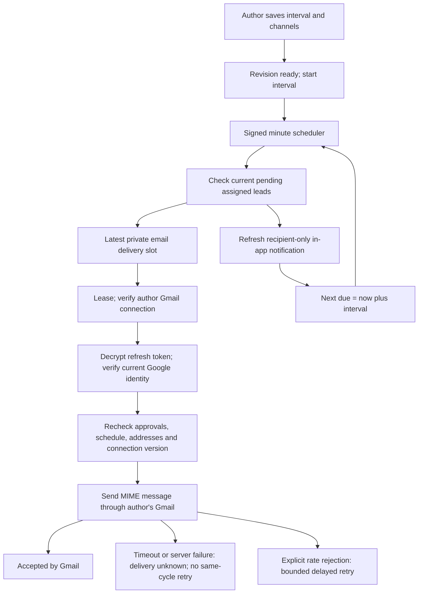

# Repeating approval reminders

15 October 2026

Authors set a repeating approval reminder for a request. The private scheduler creates in-app notifications and sends optional emails directly from the author's connected Gmail account. No Gemini call or Resend sender is involved.

## Use the schedule

1. Save the request and expand **Approval reminder schedule** in its status sidebar.
2. Choose **Connect Gmail**, sign into the same Google account used for HandoffCheck, and grant sending permission. This connects your mailbox for all your requests.
3. Enable **Repeat reminders**, select **Email reviewers too** if wanted, and choose an interval from 15 minutes to 7 days.
4. Choose **Save reminder schedule**. Connecting Gmail alone does not enable a reminder schedule.

A draft can have a saved schedule. The timer starts when its revision becomes ready for approval. Clarification, failed/running review and a new draft suspend it. A new approval round starts a fresh interval. Partial approval preserves the remaining lead's timer. Approval, archive and pause stop sending. Only the author changes the schedule; assigned leads can read it after submission.

For example, an author chooses two hours. Both pending leads receive an in-app reminder after two hours; selected emails send from the author. Once the product lead approves, only engineering receives subsequent reminders. Engineering approval stops the schedule.

Every cycle refreshes the reviewer's existing in-app notification and makes it unread. **Review reminders** shows its timestamp and links to Approvals. Records persist while the app is closed. Desktop push is not implemented.

## Configure Google once

Use the existing HandoffCheck **Web application** OAuth client in [Google Auth Platform → Clients](https://console.cloud.google.com/auth/clients). A new client is not required. Leave the existing Supabase sign-in redirect intact.

1. Enable the [Gmail API](https://console.cloud.google.com/apis/library/gmail.googleapis.com) in that Google Cloud project.
2. Add this exact **Authorized redirect URI** to the web client:

   ```text
   https://dpwzjmqvsqifbgspoylc.supabase.co/functions/v1/handoff-api/gmail/callback
   ```

3. In Google Auth Platform → Data Access, add `https://www.googleapis.com/auth/gmail.send`. The flow also requests `openid` and `email` to verify the sender. It does not request inbox reading, Google password access or send-as aliases.
4. While the external app is in Testing, add each pilot author under Audience → Test users. Google documents a seven-day refresh-token lifetime for external testing apps with these scopes; authors may need to reconnect. Public use of this sensitive scope requires the applicable Google verification process. See [Google OAuth token expiration](https://developers.google.com/identity/protocols/oauth2#expiration) and [Gmail scopes](https://developers.google.com/workspace/gmail/api/auth/scopes).
5. Save these values in [Supabase → Edge Functions → Secrets](https://supabase.com/dashboard/project/dpwzjmqvsqifbgspoylc/functions/secrets):

   | Name | Value |
   | --- | --- |
   | `GOOGLE_GMAIL_CLIENT_ID` | Existing web client's ID, ending in `.apps.googleusercontent.com` |
   | `GOOGLE_GMAIL_CLIENT_SECRET` | Secret belonging to that same web client |
   | `GMAIL_TOKEN_ENCRYPTION_KEY` | Base64-encoded 32 random bytes, generated once for this deployment |

The deployment operator provisions the encryption key separately. Preserve it: replacing it makes existing encrypted connections unreadable and requires reconnection. These are Edge Function secrets, not frontend `VITE_` variables, `.env.local` browser configuration or Apps Script properties. Supabase Authentication → Google provider settings continue to serve ordinary login.

`RESEND_API_KEY` and `REMINDER_EMAIL_FROM` are unused by this reminder implementation. There is no shared-address fallback.

Configuration presence enables the Connect button; it does not prove that the OAuth client, scopes or redirect are correct. Each author must still authorize Google. The existing signed private scheduler remains required.

## Connection and delivery flow

```mermaid
sequenceDiagram
  participant A as Author
  participant UI as HandoffCheck
  participant API as Private API
  participant G as Google
  participant DB as Private database
  A->>UI: Connect Gmail
  UI->>API: Authenticated request and saved request ID
  API->>DB: Author check; save hashed single-use state and encrypted PKCE verifier
  API-->>UI: Google consent URL
  UI->>G: Open consent
  G->>API: Callback code and state
  API->>DB: Consume unexpired state
  API->>G: Exchange code; verify Google identity
  API->>DB: Store encrypted refresh token if connection version is current
  API-->>UI: Return to request with connection result
```



OAuth state expires after ten minutes and is consumed once, including denied consent. A newer connection attempt or disconnect invalidates older callbacks. The Google subject and verified email must match the initiating user's trusted Auth identity. Return URLs are limited to approved application origins and saved request routes. Tokens never return to the browser; refresh tokens and PKCE verifiers use AES-GCM with purpose/owner binding. Credentials and state tables deny client table access. The worker uses short-lived access tokens in memory.

**Disconnect Gmail for all my requests** clears the stored refresh token, invalidates pending connection attempts and cancels queued emails. Login and in-app schedules continue. This removes HandoffCheck's stored credential; users may also remove the app under their Google account's third-party connections. Expired/revoked permission requires reconnecting. A Windows author completes consent in the system browser; the desktop view refreshes its connection state on return or polling. No installer update is needed.

The dispatcher scans at most 50 due requests and attempts at most two emails per invocation. Times display in the workspace timezone; intervals use elapsed time. Downtime produces one current cycle without a catch-up burst. Queueing and AI processing run independently. Delivery normally follows a minute scan but can be delayed by outages or backlog.

Each review/recipient has one private delivery slot. Retries preserve its destination, sender, title, revision and trace Message-ID. Gmail does **not** offer the previous transport's idempotency contract. Before sending, the worker records that sending has started. A lost response, HTTP 5xx or expired lease after that point becomes **delivery unknown**, with no automatic resend in that cycle. Explicit HTTP 429 rejection and transient failures before sending can retry, at most three attempts within 23 hours. The next regular reminder cycle may send again if approval remains pending.

**Accepted by Gmail** means the send API accepted the message; inbox delivery is not confirmed. Messages normally appear in the author's Sent folder. No bounce or delivery webhook is implemented. A message already in flight may arrive after a simultaneous approval, pause or disconnect; it cannot be recalled. See [Google's sending API guide](https://developers.google.com/workspace/gmail/api/guides/sending).

Only current active assigned pending leads' verified Auth email addresses are destinations. Authors cannot type arbitrary recipients or impersonate another sender. Emails contain the title, revision and authenticated app link, without full requirements, files or signed download URLs. Google processes those message contents and addresses.

## Defaults and verification

A saved author schedule overrides the workspace's one-time in-app reminder, including when paused. Requests without an author schedule retain the admin's one-time behavior. Other members and administrators have no automatic request-content access. Revision/version checks protect saves. Reminder changes do not change requirements or approvals or consume AI budget.

Private tables have RLS and no client table privileges, including TRUNCATE. Guarded RPCs serve participant metadata; OAuth state/credential operations and mail finalizers are service-only. Payloads clear on terminal delivery or cancellation; terminal delivery slots follow workspace retention. This is latest-cycle state, not a complete email history. The local demo marks hosted timers and Gmail connection unavailable.

Synthetic tests cover encryption owner binding, OAuth consent/identity mismatch, denied consent, stale callbacks, single-use/expired state, disconnect invalidation, private table permissions, current approval checks, frozen retries, unknown delivery handling, schedule transitions and author-only controls. Browser checks include keyboard expansion, save recovery, Gmail disconnect/error states, lead read-only access and 320-pixel layout. They never contact Google or send real email. Live consent and inbox acceptance remain owner-run checks.
