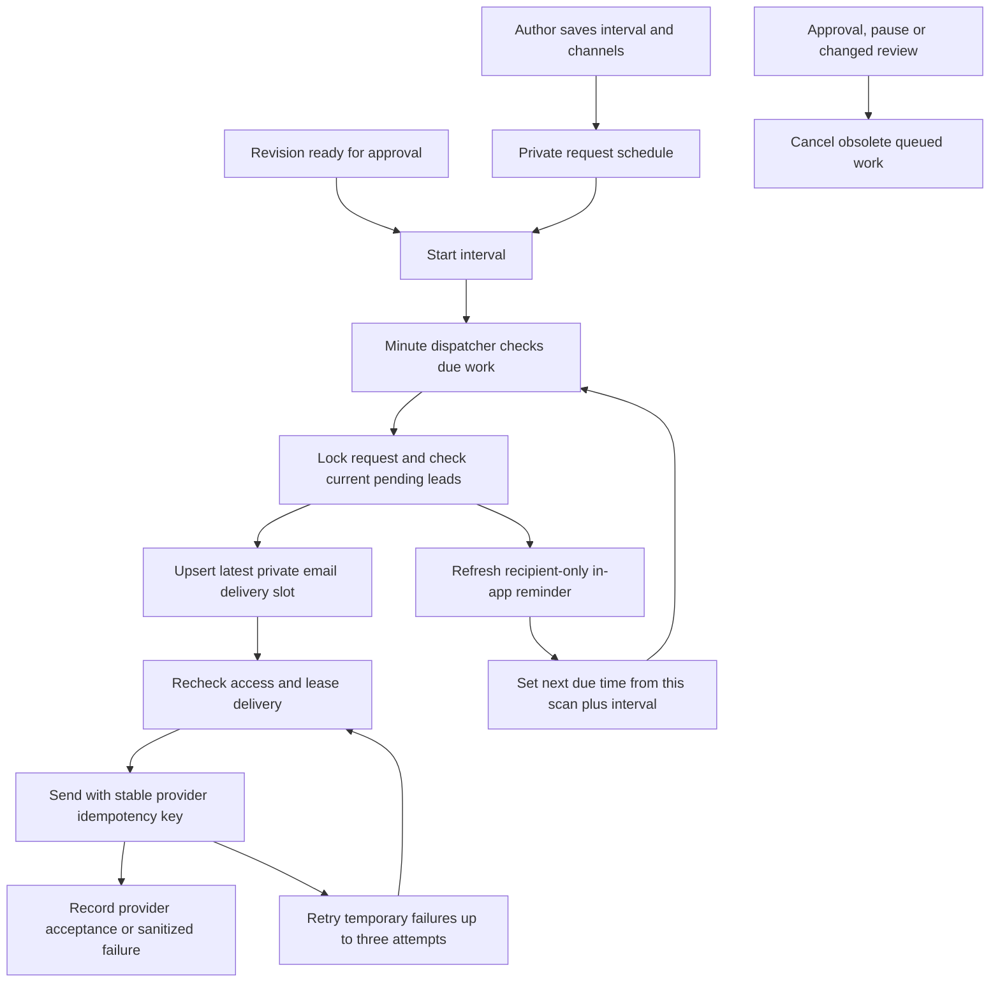

# Repeating approval reminders

15 October 2026

Authors can set a repeating approval reminder for a request. The private scheduler creates in-app notifications and submits optional emails through Resend. No Gemini call is involved.

## Use the schedule

1. Save the feature request and open its detail page.
2. Expand **Approval reminder schedule** in the status sidebar.
3. Enable **Repeat reminders**, choose minutes/hours/days, and choose **Email reviewers too** if wanted.
4. Choose **Save reminder schedule**. Allowed intervals are 15 minutes to 7 days.

A draft can have a schedule saved in advance. The timer starts when this revision is ready for approval. Clarification, failed/running review and a new draft revision suspend it. A new valid approval round starts a fresh interval. The first lead's approval does not restart the other lead's timer. Completed or archived requests stop sending. Authors can change or pause their schedules. Assigned leads can read saved settings but cannot change them.

For example, an author selects two hours. Two hours after the revision becomes ready, both pending leads receive an in-app reminder and an email is queued for each if selected. Product approval then removes the product lead from the next cycle. Engineering approval stops reminders altogether.

Each cycle refreshes the existing in-app notification for that reviewer/revision and makes it unread again. **Review reminders** shows its timestamp and links to Approvals. The system stores these records while the app is closed; it does not send desktop push notifications. Email can reach reviewers while they are away.

## Set up Resend privately

1. Sign in to [Resend Domains](https://resend.com/domains). Add a domain or subdomain you control, such as your company's sending domain.
2. Copy the DNS records Resend provides into your domain provider and wait for verification. Follow its [domain setup guide](https://resend.com/docs/dashboard/domains/introduction). A Gmail account does not give you DNS control of `gmail.com`; the app's `vercel.app` address is also not your sending domain.
3. Create a key at [Resend API keys](https://resend.com/api-keys), with sending access and domain scope where available.
4. Open [HandoffCheck Supabase Edge Function secrets](https://supabase.com/dashboard/project/dpwzjmqvsqifbgspoylc/functions/secrets). Save:

   | Secret | Private value |
   | --- | --- |
   | `RESEND_API_KEY` | Your Resend sending key |
   | `REMINDER_EMAIL_FROM` | Your verified sender, for example `HandoffCheck <reminders@your-company.example>`; replace the example domain |

5. Reopen the request's reminder schedule. **Email setup is pending** disappears when a key and a valid sender format are present. This checks configuration presence, not provider acceptance. The next due cycle or queued retry attempts sending. Use a synthetic request and consenting test accounts for inbox acceptance.

Keep keys out of chat, frontend environment variables, Apps Script and the repository. The existing private scheduler must be configured; this pilot already uses signed worker calls, Vault and minute Cron. No Google scope, Apps Script or Windows installer update is needed.

Email starts selected in a new unsaved schedule. Saving enabled repeat reminders with that selection opts the request into email. Missing Resend configuration does not prevent in-app scheduling. The worker postpones unconfigured mail for an hour, or until a newer cycle replaces it; the UI shows the setup state. Provider rejection appears as a failed cycle, not a sent email.

Only the active assigned pending lead's verified Auth email is used. Authors cannot supply another destination. The message contains the feature title, revision and authenticated app link; no full requirements, files, signed download URLs or recipient lists. Resend processes this message and address. The Google Workspace pipeline remains separate.

## Delivery flow

The existing dispatcher invokes the worker for due schedules, email retries, AI jobs, default reminders or daily maintenance. The migration updates the dispatcher condition without reading or replacing its Vault signing secret. Durations use elapsed time; dates display in the workspace timezone. Delivery follows a later scan, usually within a minute, and may be delayed by downtime/backlog.

Request locks serialize reminder cycles against approvals and saved settings. A scan advances each due schedule once. Downtime produces one current cycle, without a catch-up burst. At most 50 due requests are processed per invocation. At most two emails are attempted per worker invocation; remaining work waits for later scans. Mail and existing AI processing run independently.

One email slot is kept per review/recipient. New cycles replace older queued/failed work with a new delivery key, without overwriting a live sending lease. Retries retain a frozen destination, title and revision plus the same provider key. Every claim rechecks plan version, current review, active role, pending approval and verified address. A changed address cancels the old payload. Temporary HTTP 429/5xx or uncertain network failures retry after delays, with three attempts maximum. Retries stop after 23 hours, within Resend's documented [24-hour idempotency window](https://resend.com/docs/dashboard/emails/idempotency-keys).

**Accepted by Resend** does not confirm inbox delivery. Delivery/bounce webhooks are not implemented. An email already in flight may arrive just after a simultaneous approval or pause; it cannot be recalled. Subsequent claims are cancelled. See the [Resend email API](https://resend.com/docs/api-reference/emails/send-email).

## Permissions and defaults

- Active authors configure their own requests. Assigned leads read the schedule after submission. Other members and administrators have no automatic request-content access.
- Saving checks the schedule version and expected requirement revision. It does not edit requirements, reset approvals or consume an AI attempt.
- A saved setting overrides the workspace's one-time reminder. Pausing also suppresses that default for this request. Requests without an author setting keep the original one-time behavior when enabled by the admin; that default does not email.
- `request_reminders` and `reminder_emails` have RLS and no client table privileges, including `TRUNCATE`. Reads/saves use guarded RPCs; email claim/finalization is service-only. Internal recipient helpers cannot be called by clients.
- Retry payloads are private and cleared on success, permanent failure, pause or cancellation. Terminal slots follow the existing workspace retention window. This is latest-cycle state, not a complete email history.
- The local demo explicitly reports hosted timers unavailable. Automated provider/browser tests use synthetic transports and never send real mail.

## Verification

Database cases cover preconfigured drafts, author-only writes, reviewer reads, version checks, repeating cycles without duplicate same-cycle sends, unread refresh, separate lead approvals, revision restarts, paused defaults, private helper/table access, stable email retries, retry caps and role-change cancellation. Browser cases cover keyboard expansion, author editing, duration bounds, failed-save recovery, pending email setup, pause, read-only lead view and 320-pixel layout. Live inbox delivery remains a separate acceptance step after the owner configures Resend.
