# HandoffCheck Diagrams

These diagrams describe the proposed product-to-engineering application. They are design artifacts, not evidence of deployed services.

| Diagram | View | Editable Mermaid source |
| --- | --- | --- |
| System and external platforms | [System diagram](system.svg) | [system.mmd](system.mmd) |
| Google login and invitation check | [Authentication diagram](authentication.svg) | [authentication.mmd](authentication.mmd) |
| Request states and revisions | [Lifecycle diagram](lifecycle.svg) | [lifecycle.mmd](lifecycle.mmd) |
| Relational data model | [Data model](data-model.svg) | [data-model.mmd](data-model.mmd) |
| Checklist and AI review | [Review sequence](review.svg) | [review.mmd](review.mmd) |
| Product and engineering approval | [Approval sequence](approval.svg) | [approval.mmd](approval.mmd) |
| Deployment order | [Deployment diagram](deployment.svg) | [deployment.mmd](deployment.mmd) |
| Screen navigation | [Navigation diagram](navigation.svg) | [navigation.mmd](navigation.mmd) |
| Forms, Sheets, app and approved Docs | [Google Workspace diagram](google-workspace.svg) | [google-workspace.mmd](google-workspace.mmd) |
| Windows app and system-browser login | [Desktop authentication](desktop-auth.svg) | [desktop-auth.mmd](desktop-auth.mmd) |
| AI assistance and human approval | [Automation workflow](automation-workflow.svg) | [automation-workflow.mmd](automation-workflow.mmd) |
| Automation worker and Linear handoff | [Automation system](automation-system.svg) | [automation-system.mmd](automation-system.mmd) |

The `.mmd` files in this folder are the editable diagram sources. [Architecture.md](../Architecture.md) and [Design.md](../Design.md) embed their rendered SVGs, so readers see the intended neutral palette without a Markdown viewer's default Mermaid theme. Update the source and relevant specification together, then render the SVG with [mermaid-config.json](mermaid-config.json).

Render with Mermaid CLI:

```text
mmdc -i system.mmd -o system.svg -c mermaid-config.json -b white
node normalize-svg.mjs
```

The CLI is a documentation tool and does not need to become an application runtime dependency. Rendering requires its supported Chromium/Puppeteer setup. No backend credentials belong in these files.

Run the normalizer after rendering to replace Mermaid's generated gradient definitions with the configured solid border color. It processes only SVGs in this folder.

## System overview



## Data relationships



The full tables, constraints, permission rules, and retention behavior are in Architecture.md. The ER diagram summarizes relationships; it does not replace the transaction and RLS specifications.
